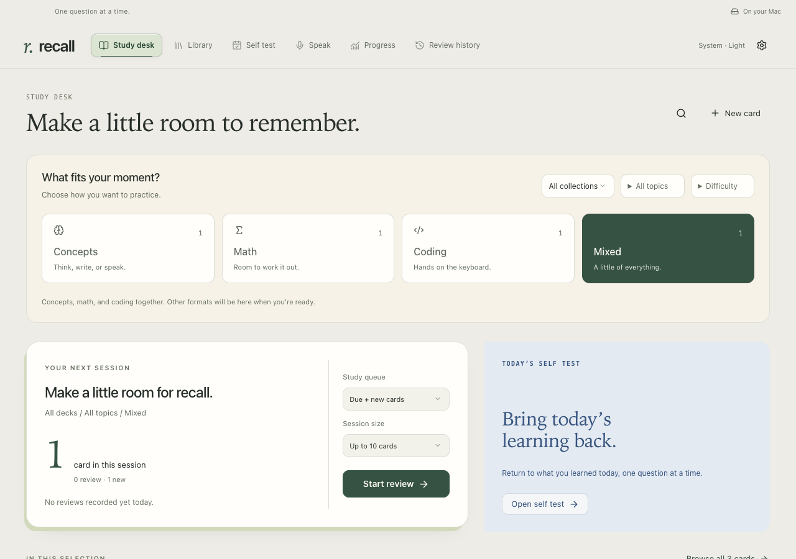
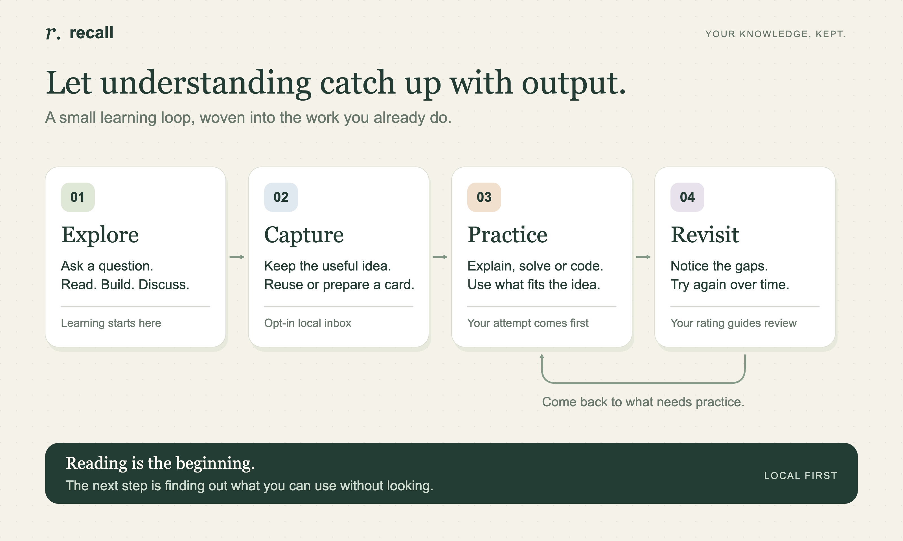
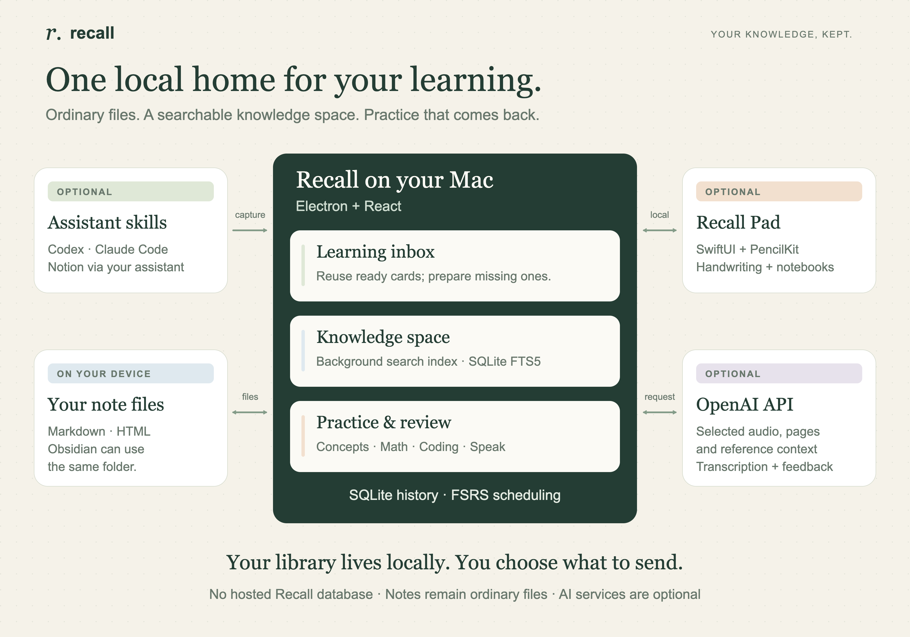

In the world of AI, we consume more text and move faster than ever. But how much do we actually learn and retain? Recall helps you capture what you're learning, keep it organized, and test yourself—so more of it stays with you.

> “All of learning is anti-forgetting.”
>
> — [Andrew Huberman, Huberman Lab](https://www.hubermanlab.com/episode/your-top-health-questions-answered)

# Recall

**Your knowledge. A place to keep it. A way to practice it.**

A local Mac app for notes, flashcards, coding challenges, math practice and spoken explanations. An optional iPad companion adds handwriting and personal notebooks.

**[Download for Mac](https://github.com/justslee/recall/releases/tag/v0.6.0-beta.10) · [Illustrated setup guide](docs/SETUP.md) · [See it in use](docs/demos/README.md) · [Get help](docs/TROUBLESHOOTING.md)**

[](https://github.com/justslee/recall/actions/workflows/verify.yml)

<a id="start-in-five-minutes"></a>
<a id="get-started"></a>

## Start here

You need an **Apple Silicon Mac (M1 or newer) running macOS 13 or later**.

1. **Download** the newest release's **Mac app ZIP** under **Assets**. Choose the file ending in `macos-arm64.zip`, rather than GitHub's “Source code” ZIP.
2. **Install:** double-click the ZIP, drag **Recall.app** into **Applications**, and open it there.
3. **Try one session:** choose **Try a short session**. Or choose **Import cards** to bring a compatible Anki deck.

The download is signed and notarized. **No Terminal, Node, API key, knowledge base or iPad is needed to start.** Ordinary card review works offline after installation. Appearance follows your Mac.



_Demo content shown. [See dark mode](docs/images/study-desk-dark.png)._

## Build a learning habit around your work



With capture enabled, your assistant records useful concepts in a local inbox. Existing questions are reused; missing ones are prepared separately. **Self Test** brings captured learning back by day. Capture records exposure, not mastery.

A simple daily rhythm:

1. **Learn:** ask questions in your connected assistant. It answers first, then captures a short receipt; new card preparation happens separately.
2. **Keep:** save longer explanations in **Knowledge** when useful. Press **⌘K** to find them again.
3. **Test:** open **Self Test** for a captured learning day, or **Study desk** for scheduled reviews. Choose a topic or collection and the format you have room for:

| Practice     | What you do                                                                              |
| :----------- | :--------------------------------------------------------------------------------------- |
| **Concepts** | Explain an idea from memory; check definitions, examples and useful interactive visuals. |
| **Math**     | Solve a problem and reveal its worked solution when you're ready.                        |
| **Coding**   | Complete a Python or C++ challenge with starter code and tests.                          |
| **Mixed**    | Combine the formats you want in one session.                                             |

Your **Again / Hard / Good / Easy** rating schedules the next review. Optional AI feedback never rates a card for you. **Progress** shows recorded practice; **Knowledge → My Brain** maps connected ideas and review evidence.

## Add only what you need

Start with one option. You can add the others later from the **gear icon → Connections**.

| I want to…                                     | Start here                                                                                                          | What I need                                                                  |
| :--------------------------------------------- | :------------------------------------------------------------------------------------------------------------------ | :--------------------------------------------------------------------------- |
| **Keep notes in Recall**                       | **Knowledge → Create a space → New note**. [Guide](docs/KNOWLEDGE_SPACE.md)                                         | A local folder for Markdown or HTML files.                                   |
| **Use existing notes**                         | Connect Markdown, Obsidian or Notion. [Guide](docs/SETUP.md#choose-a-home-for-your-knowledge)                       | A folder/vault, or an assistant with Notion connected.                       |
| **Capture learning with Codex or Claude Code** | Connect, enable capture, start a fresh chat, then **Verify learning**. [Guide](docs/SETUP.md#learning-capture)      | Your assistant account/client.                                               |
| **Practice explaining aloud**                  | Connect **Think out loud**, then open **Speak**. [Guide](docs/demos/SPEAK.md)                                       | An OpenAI API key with billing; separate from ChatGPT.                       |
| **Write with Apple Pencil**                    | Install Recall Pad, then pair it in **Connections → Write on iPad**. [Guide](docs/SETUP.md#optional-ipad-companion) | An iPad on iPadOS 17+, Apple Pencil, and a separate Recall Pad installation. |

**No knowledge base yet?** Create a local space and start writing, or [set up Markdown, Obsidian or Notion](docs/SETUP.md#create-your-first-knowledge-base). Recall and Obsidian can share one folder. Notion updates go through your assistant; there is no continuous two-way sync.

**Recall Pad has three uses:** answer a Recall card, work through a problem with your chat tutor, or keep private notebooks. In a connected Codex paper session, the prompt and submitted pages belong to the same conversation; ask for a hint or say **“Check my paper”** to continue. Notebook pages reach Recall only when you select and send them. [iPad walkthrough](docs/demos/PAPER.md)

**The iPad app is in beta.** Invited testers use TestFlight; there is no public invitation yet. Developers can [build it with Xcode](docs/IPAD_NATIVE.md). Install it separately and pair once; ordinary restarts keep that connection.

## Get the latest update

**In v0.6.0-beta.10 or later:** open **gear icon → General → Recall updates → Check for updates → Update & restart**. Recall verifies the download, replaces the app in the same location, reopens your library and retains one previous app for recovery.

**On an older version?** Quit Recall, download the newest Mac app ZIP, then replace the existing **Recall.app** in Applications. Your cards, notes and history stay in place. If you use an assistant, open **Connections → Codex or Claude → Refresh instructions**, then start a fresh chat.

New cards appear without restarting. [More update options](docs/SETUP.md#update-an-existing-installation)

If you installed **beta.3 or beta.7**, update to **beta.10 or later**. Those older downloads were withdrawn because they contain dependency versions with known security advisories. [Review details](docs/history/SECURITY_REVIEW_2026-11-08.md)

## How it works

The Mac app uses **Electron + React**. **SQLite** stores cards and review history; **FSRS** schedules reviews from your ratings. Local Markdown/HTML notes remain the source of truth, with a separate **SQLite FTS5** index maintained in a background worker. Codex/Claude skills connect learning and card preparation through a local queue.

<details>
<summary>See the architecture and optional connections</summary>



Recall Pad uses **SwiftUI + PencilKit**, paired to the Mac over authenticated local HTTPS/WebSocket connections. A scoped MCP connection supports the paper-learning workflow. Optional OpenAI requests provide transcription and answer feedback. [Implementation and verification boundaries](docs/IMPLEMENTATION.md)

</details>

## Your data stays yours

There is **no hosted Recall database or telemetry service**. Your learning profile stays local. Optional AI features send selected context to the provider; notebook submissions and learning capture are explicit choices. Saved API keys live in an owner-only local file, outside library exports and backups.

The repository includes reusable skills and demo content, with no personal cards or credentials. Interactive diagrams load on request in a sandbox. Coding exercises require source review and an explicit **Run** action.

[Privacy](docs/PRIVACY.md) · [Security](SECURITY.md) · [Backups](docs/MIGRATION.md)

## Customize or build

Ask Codex or Claude to make card answers more concise, adjust visual styles, or change your learning workflow. [Customization guide](docs/CUSTOMIZE.md) · [Card authoring](docs/AUTHORING.md) · [Learning skills](skills/)

<details>
<summary>Clone and build from source</summary>

Install **Node.js 24 or later** first using the [official installer](https://nodejs.org/en/download); npm is included. Recall does not install Node for you. The packaged Mac download above includes its own runtime.

```sh
git clone https://github.com/justslee/recall.git
cd recall
npm run setup -- --no-launch
npm run package
```

Copy **release/Recall-darwin-arm64/Recall.app** into Applications and open it. A local build does not inherit the publisher's signing or notarization. [Detailed build instructions](docs/SETUP_REFERENCE.md#install-and-open-recall) · [Contributing](CONTRIBUTING.md)

</details>

[All guides](docs/README.md) · [Why I built Recall](docs/launch/ARTICLE.md)

Built by [justslee](https://github.com/justslee). Code: **MIT**. Original demo content: **CC0-1.0**. Imported material retains its own terms. Recall is not affiliated with the services it connects to.
