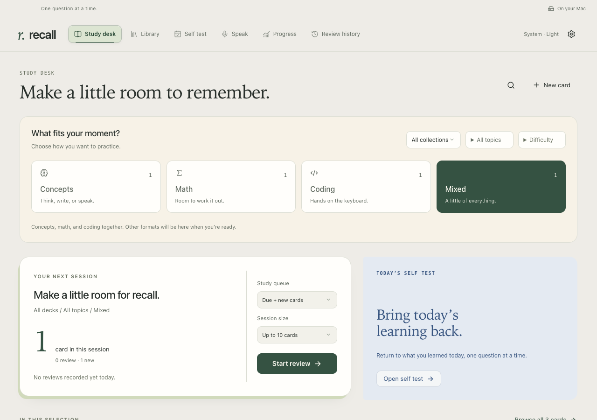
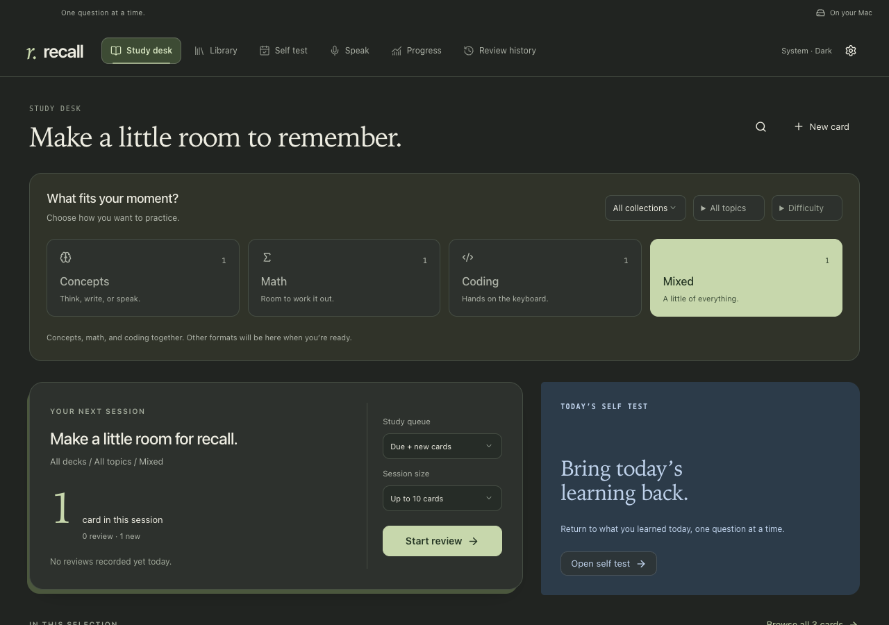

In the world of AI, we consume more text and move faster than ever. But how much do we actually learn and retain? Recall helps you continuously capture what you’re learning, log it, and test yourself—so more of it stays with you.

> “All of learning is anti-forgetting.”
>
> — [Andrew Huberman, Huberman Lab](https://www.hubermanlab.com/episode/your-top-health-questions-answered)

# Recall

**Turn what you learn into what you can recall.**

A local study desk for concepts, mathematics and code—with a knowledge-base connection, daily self-tests, spoken explanations and an optional iPad notepad.

**Mac · Local first · Light & dark · Your own knowledge**

**[Start here: illustrated setup guide →](docs/SETUP.md)**

[See Recall in use](docs/demos/README.md) · [Get updates](#get-the-latest-update) · [Get help](docs/TROUBLESHOOTING.md)

|                                             Light                                             |                                                 Dark                                                 |
| :-------------------------------------------------------------------------------------------: | :--------------------------------------------------------------------------------------------------: |
|  |  |

_Appearance follows your Mac. All documentation screenshots use original demo or synthetic content._

## Get started

You need an **Apple Silicon Mac running macOS 13 or later**.

Download the **Mac app ZIP** from [GitHub Releases](https://github.com/justslee/recall/releases), unzip it, move **Recall.app** to **Applications**, and open it. The signed, notarized app includes its runtime: **no Node, Terminal or source build is needed**.

The [illustrated setup guide](docs/SETUP.md) takes you from download to your first study session. It keeps the knowledge base, assistant connections and iPad setup on the same page, with screenshots and optional sections. Developers can still [build from source](docs/SETUP_REFERENCE.md#install-and-open-recall); that route requires **Node.js 22.18 or later**, installed separately.

Choose **Try demo** for three original sample cards, **Import cards** for a compatible Anki deck, or **Connect learning** to make the system yours. You can study without an account, API key, knowledge base or iPad. Setup needs internet; ordinary study works offline afterward.

> [!NOTE]
> This is a beta. Mac updates are manual. Recall Pad is a separate iPad app: invited testers use TestFlight, and a [personal Xcode build](docs/IPAD_NATIVE.md) remains available. There is no public TestFlight invitation yet.

## Choose the practice you have room for

| Format       | Your task                                   | What helps                                         |
| :----------- | :------------------------------------------ | :------------------------------------------------- |
| **Concepts** | Explain the idea from memory.               | Definitions, concrete examples and useful visuals. |
| **Math**     | Solve on paper or iPad, or enter an answer. | Worked steps, revealed when you choose.            |
| **Coding**   | Complete a focused Python or C++ challenge. | A matching editor, starter code and tests.         |
| **Mixed**    | Combine formats that fit your session.      | Independent review history for each question.      |

Choose a **topic** or **collection** separately from format. Cards can contain LaTeX, images and interactive diagrams. Your own **Again / Hard / Good / Easy** rating drives the next review; optional AI feedback never rates a card for you.

[Walk through a study session →](docs/demos/STUDY.md)

## Connect your learning

**Learn → capture → self-test → revisit.**

Recall includes a portable skill kit for Codex and Claude Code. Connect once, then learn in your other local projects. Suitable cards are reused; genuinely missing objectives are prepared and validated. Receipts distinguish **new**, **reused** and **pending** work.

A knowledge base is optional. Create or connect **Local Markdown**, **Obsidian**, **Notion**, or several destinations. Choose a primary home, optional mirrors and scoped read-only or authoring access. Notion needs your assistant's working connector; mirrors follow verified primary writes rather than continuous two-way sync.

Capture is opt-in. It records what you actually discuss, without inferring mastery. Daily scheduling and scoped catch-up are separate choices. Say **“Don't capture this discussion”** to keep it out.

[Set up the connections →](docs/SETUP.md#learning-capture) · [See the learning-to-Self-Test flow →](docs/demos/LEARNING.md)

## Explain it. Write it. Test it.

| When you want to…                                  | Use…                                             | See it in action                                                          |
| :------------------------------------------------- | :----------------------------------------------- | :------------------------------------------------------------------------ |
| Answer a card aloud or in writing                  | The compact **Speak / Type** strip.              | [Study walkthrough](docs/demos/STUDY.md)                                  |
| Explain a concept or your own topic to an audience | **Speak**, with references and focused coaching. | [Speak walkthrough](docs/demos/SPEAK.md)                                  |
| Solve a Recall question with your Pencil           | **Recall Study** in the optional iPad app.       | [Paper walkthrough](docs/demos/PAPER.md)                                  |
| Work by hand during an assistant conversation      | Chat-linked **Tutor Pad**.                       | [Paper-learning workflow](docs/demos/PAPER.md#learn-with-your-chat-tutor) |
| See what needs more practice                       | **Progress** and **Review history**.             | [Review your learning](docs/demos/LEARNING.md#test-the-day)               |

Voice transcription, Speak evaluation and Recall's handwriting assessment use an optional **OpenAI API account with billing**, separate from a ChatGPT subscription. Chat-linked Tutor Pad uses your existing assistant conversation instead. No Accessibility permission or automatic chat sending is part of the paper workflow.

## Get the latest update

1. Back up in **Settings & backups → Library & backups**, finish recordings or evaluations, then quit Recall.
2. Download the newest **Mac app ZIP** from [GitHub Releases](https://github.com/justslee/recall/releases) and unzip it.
3. Move **Recall.app** to its existing Applications location, choose **Replace**, and reopen it. Follow any release notes about refreshing assistant connections.

Your library lives separately from the app. Updating preserves your cards, study history and configuration. **New cards appear while Recall is open**; an app-code update requires restarting. There is no automatic Mac updater yet. Source users and custom profiles have [detailed update instructions](docs/SETUP_REFERENCE.md#update-an-existing-installation).

**Recall Pad:** open **TestFlight → Recall Pad → Update**, or enable **Automatic Updates** on its TestFlight page. Save an open sheet before updating. Keep the app installed so its local sheets remain available. [iPad update details →](docs/SETUP.md#update-recall-pad)

## Your data stays yours

Recall has no hosted database or telemetry service. Cards, reviews, drafts and learning logs stay in your local profile. Optional provider requests send selected context; backups and exports can contain private learning material and should remain private.

Interactive widgets load only when requested inside a sandbox. Native coding runs require source review and an explicit **Run** action. Saved API keys stay in a local owner-only file and are excluded from Recall exports and profile backups.

**A clone contains the reusable system:** app source, learning skills, original demo cards, setup guides and contributor tools. It does not include the author's cards, knowledge base, API keys, paired devices or completed Apple submission records. Your own library is created locally. Build archives, debug symbols and private release evidence stay outside Git; the [publisher templates](docs/submission/README.md) are optional references for people distributing their own build.

[Privacy & execution](docs/PRIVACY.md) · [Security](SECURITY.md) · [Backups and migration](docs/MIGRATION.md)

## Go further

**Start:** [Illustrated setup](docs/SETUP.md) · [Walkthroughs](docs/demos/README.md) · [Troubleshooting](docs/TROUBLESHOOTING.md)

**Customize:** [Card authoring](docs/AUTHORING.md) · [Interactive visuals](docs/WIDGETS.md) · [Learning skills](skills/)

**Develop:** [Contributing](CONTRIBUTING.md) · [Advanced setup](docs/SETUP_REFERENCE.md) · [All references](docs/README.md)

Built by [justslee](https://github.com/justslee). Code is **MIT**; original demo content is **CC0-1.0**. Imported material retains its own terms. Recall is not affiliated with the services it connects to.
