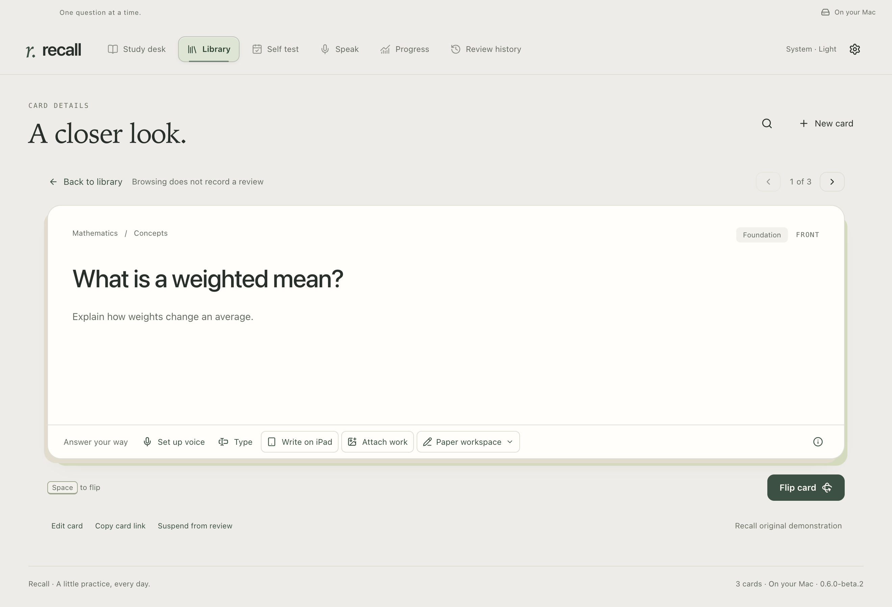

# Recall Pad

[Documentation](README.md) · [Native build guide](IPAD_NATIVE.md) · [Privacy](PRIVACY.md#ipad-and-handwriting)

**Detailed reference.** Start with [illustrated setup](SETUP.md) and the [Recall Pad walkthrough](demos/PAPER.md). This page covers the companion's limits, storage and recovery.

**Write naturally on your iPad. Keep every attempt. Get feedback on your Mac.**

Recall Pad is an optional native iPad companion, with a shared PencilKit notepad for two workflows:

| Mode             | Start with                                       | Finish with                                                              |
| ---------------- | ------------------------------------------------ | ------------------------------------------------------------------------ |
| **Recall Study** | A concept or math question from Recall           | Page-linked feedback in Recall on your Mac.                              |
| **Tutor Pad**    | A prompt from a connected chat, or a blank sheet | Submitted pages read in that chat, or copied manually from the Mac tray. |

It does not replace Recall's Mac library, coding editor, review ratings or progress dashboard. No hosted Recall service is required. Grading quality, real-iPad behavior, reliable transfer and same-chat image reads remain separate release checks; building the source does not establish those checks.



_Mac study controls, shown with synthetic demonstration content. The iPad writing surface requires a native device build._

## Set up once

Ordinary [Mac setup](SETUP.md) is unchanged. For the companion, you need iPadOS 17 or later, an Apple Pencil for writing, and both devices on the same local network. Building the iPad app requires full Xcode; Apple's Command Line Tools can build the Mac's Bonjour discovery helper.

From your Recall checkout:

```sh
npm run build:pad-helper
npm run build:ipad
```

The first command builds the Bonjour helper. The second bundles the locked question-rendering resources and builds an **unsigned device app**; it does not install Recall Pad on a physical iPad. Use `npm run build:ipad -- --simulator` to compile against the simulator SDK; running that app or its native tests requires an installed simulator runtime. Follow the [native build guide](IPAD_NATIVE.md) to configure your own signing identity and install through Xcode. A public TestFlight build is a separate distribution step.

Rebuild and reopen Recall from the checkout, or [replace your packaged app](SETUP.md#update-an-existing-installation). Keep the same Mac profile.

1. In **Settings & backups → iPad & handwriting**, enable the companion and choose **Pair an iPad**.
2. Open Recall Pad on the iPad, choose **Pair with Mac**, and scan the QR code.
3. Confirm your iPad on the Mac. Allow the iPad's local-network access; camera access is used to scan the pairing code.

The code is private, single-use and expires after five minutes. **Pair once per device.** Subsequent sessions reconnect to the pinned Mac identity. Removing a device, replacing the Mac identity or clearing pairing data requires pairing again; ordinary app updates do not.

## Study with your Pencil

Open a concept or math card on the Mac and choose **Write on iPad** once for the session. The iPad follows subsequent questions without another scan. Solutions and review schedules remain on the Mac.

Question text and LaTeX render locally. Embedded PNG, JPEG and WebP figures are supported, with up to four figures of 2 MiB each. Questions requiring an executable widget, vector figure or external image stay on the Mac; use Tutor Pad beside those questions. A cached session supports up to 200 fronts and 16 MiB of question content.

**Questions on your desk** shows a rolling buffer of at most **three** questions: the current question and the next two. Advancing on the Mac removes earlier questions from this list; the final question appears alone, and finishing clears the desk. Coding stays on the Mac, with upcoming concept/math questions buffered on the iPad. Your handwritten work remains in **Recent sheets**. Cached fronts remain available for offline navigation; the compact desk is not a deletion or a review rating.

Write on the scrollable plain, ruled or squared sheet. Pencil writes; fingers scroll and zoom. Undo, eraser and selection tools stay in a small toolbar. Work autosaves, and switching questions preserves each sheet.

Beside the **Pen**, tap the color swatch to choose graphite, blue, green, red, purple or amber and adjust **Pen thickness**. Select the **Eraser**, then tap its size control to adjust the erasing diameter. The eraser removes the ink you touch rather than an entire stroke. These preferences are remembered on this iPad and affect new marks; earlier ink keeps its colors and thickness. In a narrow window, swipe the toolbar to reach its other controls.

The writing surface follows **iPad Settings → Display & Brightness**: warm paper in light mode, dark forest paper in dark mode. Ink and grid lines adapt while you keep the sheet open; switching appearance preserves your strokes and selected tool. Export previews, PNG/PDF pages and thumbnails retain your ink colors on white paper for readable sharing and assessment.

Choose **Send for feedback** to save an immutable attempt and its ordered pages. Recall retains the original question/reference snapshot for that attempt. Correcting your work and resubmitting creates a new attempt rather than replacing the old one.

On the Mac, expand **Your written work** to inspect pages and feedback. The evaluator should credit valid alternative methods, distinguish arithmetic, method and conceptual errors, and request clarification for unreadable notation. **Show worked solution** and your review rating remain explicit choices. Evaluation never automatically rates a card or changes its schedule.

You can also attach, paste or drop existing images into Recall without an iPad. Existing card photos remain separate as **Earlier attachments**.

### Enable assessment

Save your own API key in **Settings & backups → Voice & feedback**, then enable handwriting feedback under **iPad & handwriting** after reviewing what is sent. Assessment requires internet and separate OpenAI API billing. Pairing and local transfers require neither an API key nor internet.

The selected pages, question and reference are sent to OpenAI only for an explicit assessment. The configured default is `gpt-6-astra`; change it explicitly if unavailable to your API project. Recall never silently substitutes another model. The key stays on the Mac.

Astra assessments request original image detail to preserve small handwritten expressions, following [OpenAI's vision guidance](https://developers.openai.com/api/docs/guides/images-vision). Other explicitly selected models use high detail for compatibility. Provider image/context limits can still reject a large attempt; work remains saved for a smaller resubmission.

Cancelled, interrupted or failed assessments keep your attempt. Retry manually: an uncertain connection failure may still have resulted in provider processing and billing. AI feedback can misread handwriting or make mathematical errors; it is formative guidance, not independently verified grading.

## Use it beside your tutor

### Connected chat

For the Codex-first [paper-learning workflow](PAPER_LEARNING.md), open **Settings & backups → iPad & handwriting → Learn on paper with your tutor** and choose **Connect Codex** or **Connect Claude Code**. Start a fresh chat, then ask it to start a paper session. This connection is separate from learning capture.

Keep discussing the subject normally. When useful, ask for a problem or writing prompt on the pad; each published prompt has its own sheet. With **Follow tutor** on, the next published prompt saves your working before switching sheets. Hints and discussion keep the same sheet. Reconnecting leaves your current work open; turn **Follow tutor** back on to continue.

Choose **Send to tutor** to save the pages on the Mac. The assistant can read selected pages into that same active turn through its tools. A tool can wait briefly for work; if the assistant is idle, say **“Check my paper”** after submitting. This does not attach to a draft, send a chat message, wake an idle chat or automatically grade each turn. Claude setup is available, and ChatGPT desktop on a supported shared Codex host can reuse the local MCP registration. Live image delivery in each client still needs separate verification; ordinary web chats do not inherit local tools.

### Manual blank sheets

Without a connected chat prompt, **Tutor Pad** continues your latest manual sheet or opens a blank one. Choose **New sheet** for a different problem. In a chat-bound sheet, **Blank sheet** opens a separate manual sheet; it does not move your original work to another prompt. Ask for a problem in any conversation you already use. On the Mac, open **File → Tutor Pad** (or the Recall Pad menu-bar item). Choose **Start receiving pages** if needed; **Page receiver ready** confirms that the tray is ready. No Recall card, reference answer, OpenAI API key or Accessibility permission is needed. Keep the shared local Mac receiver running.

Write on the iPad and choose **Send to Mac**. **Received on Mac** confirms durable storage. In the Mac tray, choose **Copy page**, switch to your chat’s message input, and paste with **⌘V**. Check the attachment and press Send yourself. Multiple pages stay ordered; copy and attach them one at a time. The iPad's export preview and system sharing offer PNG/PDF files as another route. [Page transfer details](PAD_HANDOFF.md).

Receiving pages never changes the clipboard or controls another app. There is no chat-app selector or automatic draft pasting. Feedback stays in your chosen conversation. Connected assistant tools receive only their session's selected work when invoked; manual tray delivery remains available without those tools.

Sending keeps the canvas open with a compact delivery receipt. Earlier sheets remain available. Tutor sheets do not automatically become flashcards, knowledge-base notes or Self Test captures.

To delete a sheet, use **… → Delete sheet…** in Recent sheets or the editor. A centered confirmation card names the sheet and offers **Cancel** and **Delete sheet**. Cancel keeps the current writing canvas in place. A successful deletion removes its Recent sheets row immediately, including offline. This removes its ink, local submissions and queued transfers from the iPad. Copies already received on the Mac or attached to a chat remain there. A sheet actively sending must finish its transfer before deletion.

## Offline and recovery

Downloaded question fronts, editable sheets and queued submissions stay on the iPad. You can keep writing while the Mac sleeps, Recall is quit, or the network is unavailable. Foreground reconnection transfers queued work; the Mac confirms receipt only after durable storage.

Delayed Tutor Pad work retains its original sheet and prompt binding when saved on the Mac. Connected tools can read it when invoked in its authorized session; manual pages wait for an explicit **Copy page** action. Reconnecting cannot change your clipboard, insert work into a conversation or wake an idle assistant. iPadOS may suspend the app in the background; continuous background delivery is not promised.

| Status                              | Meaning                                                                               |
| ----------------------------------- | ------------------------------------------------------------------------------------- |
| **Saved offline / Waiting for Mac** | Your work remains on the iPad; delivery has not been acknowledged.                    |
| **Received on Mac**                 | Recall saved the complete submission.                                                 |
| **Available to tutor**              | The authorized assistant tool accessed the selected pages; this is not an evaluation. |
| **Copied (Mac action)**             | You copied a page on the Mac. Paste it into your chosen application.                  |
| **Evaluating / Feedback ready**     | Assessment is running or its validated response is available on the Mac.              |

Export preview and PNG/PDF sharing provide a manual fallback for work within the submission limits. Sending captures all ink, including offscreen work, as ordered pages; it does not select only the latest strokes or the last problem. Each submission supports up to **20 pages**, **12 MiB per image**, and **64 MiB total**, including editable drawing data. Repeated pages count separately toward this limit even when their identical bytes share storage. In-app export uses the same limits. Oversized work stays saved; split future work into smaller separate sheets and submit each separately. For a chat-bound session, ask your tutor to issue smaller writing prompts; manually created sheets use the manual Mac tray.

When the companion is enabled, closing Recall's window keeps its receiver running. **Quit Recall** stops it. Opening at login is optional. If discovery fails, check local-network permission, the Mac firewall, guest-network isolation and whether Recall is running; never forward the listener to the public internet.

## Data and release boundaries

The iPad stores editable drawings, thumbnails, question fronts and its outbox locally. The Mac stores received drawings, pages, reference snapshots, tutor prompt revisions and feedback in the selected Recall profile. Profile backups contain this learning material; API keys, pairing credentials, TLS private keys and paper-session authority are excluded. Restore keeps work but disables the companion and invalidates restored tutor-session capabilities. It never automatically sends work, changes the clipboard or starts assessments. See [restore behavior](MIGRATION.md#what-restore-preserves-and-resets).

Device credentials live in the iPad Keychain and are device-only; the Mac keeps their hashes. HTTPS/WSS verifies the pinned Mac public key, and Bonjour is discovery rather than authentication. No system-wide certificate installation is required.

Before public distribution, complete the [handwriting release checks](RELEASE_CHECKLIST.md#recall-pad-release-gates): real Pencil use and recovery, actual local-network pairing, ordered transfer and explicit copying/sharing, intended-chat MCP image reads, a reviewed assessment benchmark, signed device builds and TestFlight setup. Automated and synthetic checks must be reported as such.

**Developer references:** [Native build](IPAD_NATIVE.md) · [Paper learning](PAPER_LEARNING.md) · [Manual page transfer](PAD_HANDOFF.md) · [Protocol v1](PAD_PROTOCOL.md).
