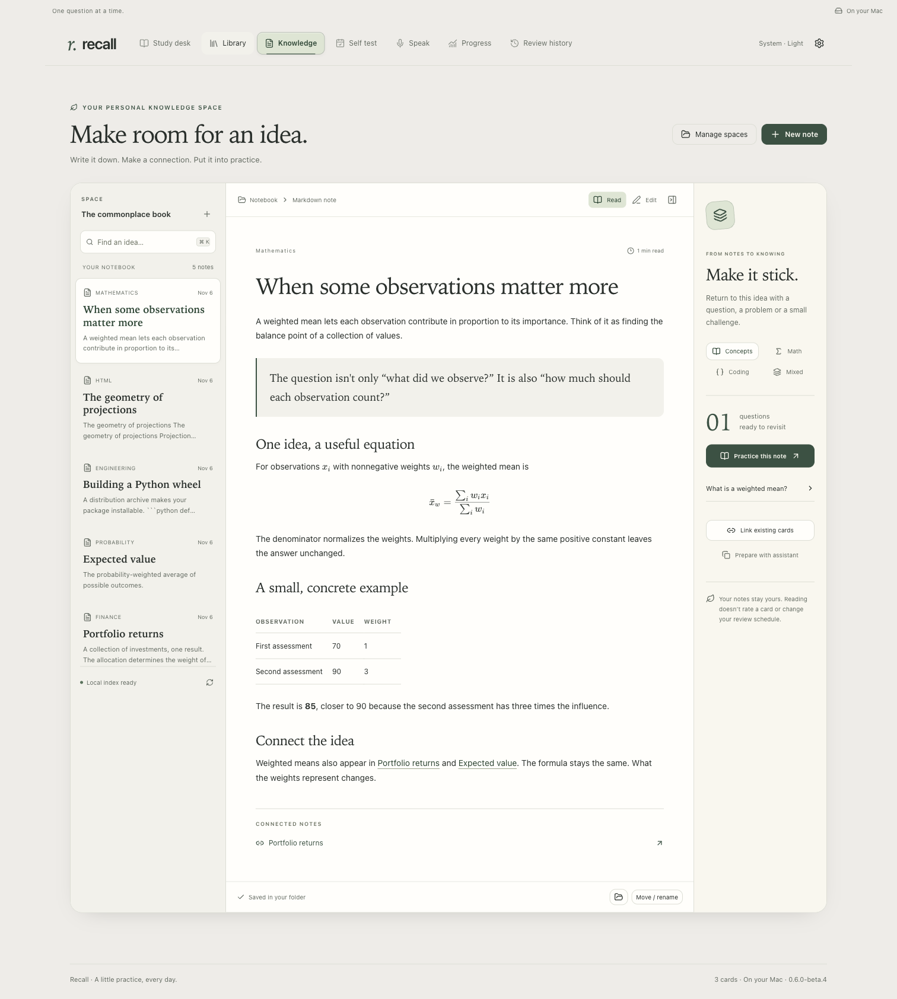
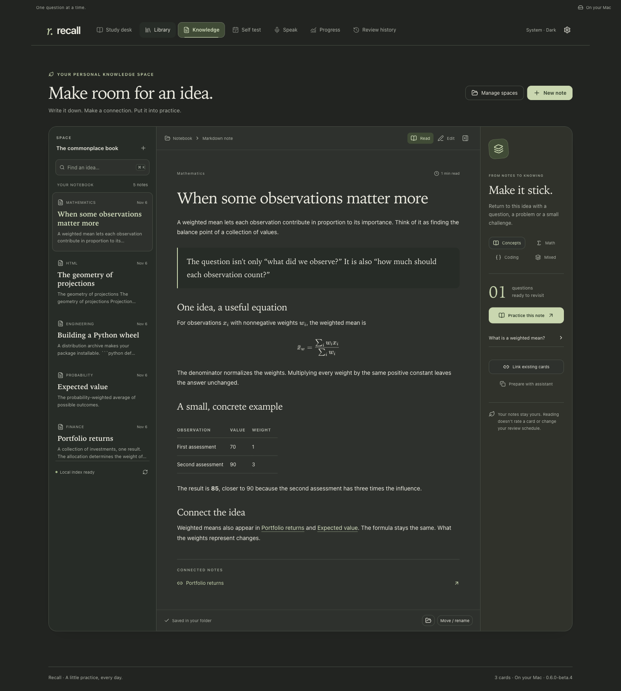

# Your Knowledge space

[Setup](SETUP.md) · [Knowledge-source connections](KNOWLEDGE.md)

**Write a note, find it, and practice it in one place.** Open **Knowledge** in the Mac app. If your older installation has no Knowledge tab, [update Recall](SETUP.md#update-an-existing-installation) first.



## Start with one folder

1. Open **Knowledge → Create a space**. Choose where its new folder should live on your Mac.
2. Choose **New note**. Give it a title, write in Markdown, and press **⌘S** to save.
3. Switch to **Read** for the formatted page. Press **⌘K** from anywhere in Recall to find an idea again.

Already have notes? Choose **Open an existing folder**, or **Manage spaces**, and connect a Markdown folder or an Obsidian vault through the existing scoped connection guide. Choose read-only access to browse, or authoring access to edit. No files are moved, mirrored, or rewritten by connecting or indexing.

Recall and Obsidian can open the same folder. There is no additional copy to keep synchronized. Notion remains an optional assistant-managed source or publishing destination; Knowledge does not migrate your Notion workspace or change which source is primary.

## Read and write

- **Read** shows Markdown or HTML with readable typography, tables, code, local images, LaTeX and Mermaid diagrams. Appearance follows your Mac.
- **Edit** exposes a focused Markdown writing area and an editable title. Metadata stays tucked away behind **Edit source & metadata**. HTML opens as editable source.
- **Save note / ⌘S** writes the original file. Unsaved edits are saved as local recovery drafts after a short pause in typing. Wait for **Draft saved on this Mac** before quitting if you have not saved the file.
- **Move / rename** moves a saved note into an existing folder in that space. Existing files are never replaced. Folder creation and file deletion remain available through Finder in this first version.
- The folder selector narrows the note shelf. Titles, aliases and full text are indexed. Search results are bounded and paginated.
- Wikilinks and Markdown note links help you move between ideas. A unique matching note opens directly; ambiguous matches open search. **Connected notes** shows explicit local backlinks.

If a file changes in another editor, Recall keeps your draft and asks you to load the current file. Saving against an outdated revision is rejected. Copy any draft text you want to retain before choosing to discard it; there is no automatic merge editor yet.

Imported HTML is a safe reading view. Scripts, document styles, privileged frames and remote images are not loaded. Inline SVG is isolated as an image, Mermaid uses the existing strict renderer, and local PNG/JPEG/WebP assets stay within the connected folder. Arbitrary executable HTML applications are outside this reader.

## Put the idea into practice

The right-hand panel connects a note to your Recall cards.

1. Choose **Link existing cards** to attach questions you already have. Exact concept IDs and explicit source references can also supply a connection.
2. Choose **Concepts**, **Math**, **Coding** or **Mixed**.
3. Choose **Practice this note**. Answers begin hidden, and you choose the review rating as usual.

An unfinished review session is preserved. Reading, editing, linking or indexing a note never rates a card, changes its content, or updates its review schedule. A note changed since a manual card link is marked for checking; this does not silently rewrite cards.

Need new questions? **Prepare with assistant** copies a scoped prompt for Codex or Claude. Paste it into your assistant to reuse or prepare cards through the established authoring and invisible validation workflow. The button itself sends no provider request and does not claim questions are ready.



## Fast lookup and ownership

The folder contains ordinary `.md`, `.markdown`, `.html` or `.htm` files. New Markdown notes have stable Recall IDs in frontmatter. Practice links and recovery drafts live in your private Recall profile; they do not alter the cards themselves.

A background worker owns the derived SQLite full-text index. It checks configured local sources at startup, watches for changed files, and reconciles metadata periodically. It reparses changed notes rather than rereading the whole folder for each search. **Refresh knowledge index** explicitly checks for missed changes. Unreadable notes remain on disk and appear as indexing issues; missing folders are reported. Limits are 2 MB per note, 200,000 directory entries per source and 32 nested folder levels. Hidden folders, symbolic links and dependency folders are skipped.

The search cache is disposable and excluded from profile backups. **Your source folders remain outside Recall's profile backup. Back them up separately**, using your normal local backup workflow. Profile backups retain recovery drafts, practice links, file identities and pre-edit backups. Restoring a profile does not overwrite external knowledge folders or publish anything to Notion.

For assistant and developer use:

```sh
# Build/reconcile the local derived index.
recall kb index

# Search an existing index without rescanning the folder.
recall kb search SOURCE_ID weighted mean

# Read the current file and revision before reuse or an authorized update.
recall kb read SOURCE_ID "Mathematics/Weighted mean.md"
```

Search returns bounded metadata and excerpts, plus index freshness. If Recall is closed, external changes are not watched; run `kb index` when fresh coverage is required. Always read the current file before authoring. A missing result in an outdated or incomplete index is not proof that a concept is absent. Existing Notion search and verified publication workflows retain their previous boundaries.

## Verification

Run `npm test`, `npm run build`, then `npm run test:knowledge-space`. The desktop journey uses a hidden disposable profile with synthetic notes, including hostile HTML. It checks math/Mermaid rendering, appearances, responsive layouts, source editing, recovery after restart, external edits, distinct practice formats and unchanged cards/reviews.

`npm run benchmark:knowledge -- 10000` measures the production index and worker against synthetic files. It reports initial indexing, unchanged metadata reconciliation and warm query round trips separately. These are local retrieval measurements, not model response times or comparisons with other note applications.

The index uses [SQLite FTS5](https://www.sqlite.org/fts5.html). Markdown is parsed by [Marked](https://marked.js.org/using_advanced) and sanitized before rendering.

## Interactive visuals in notes (source build)

A note can reuse a library card's interactive diagram through a `recall-visual` reference. It uses the same illustrated scene and controls as the card. The note itself contains no executable code.

````markdown
```recall-visual
{"cardId":"example:bounded-batches","widgetIndex":0}
```
````

Widget indexes start at zero. If widgets are disabled, choose **Enable interactive visuals for this card**, then **Load interactive**. Permission also applies to that card in the library. The isolated frame has no file, network or library access. Expand/Collapse and appearance changes retain inputs; leaving the note unloads the visual. Missing cards or widgets leave the note readable with an unavailable message. Older releases display the reference as a code block; install a release that includes this feature before adding live references.

A diagram can also belong directly to its note, without a flashcard. The local source stores its immutable asset under `Visuals/`; the note references the returned content-addressed path. Choose **Enable this visual**, then **Load interactive**. This permission is local to that note and exact asset; it does not change the study library. Keep the `Visuals/` folder when copying or backing up your Knowledge source. Missing or changed assets remain unavailable instead of running different content. See the [authoring contract](../skills/recall-source/references/widget-contract.md#note-owned-visuals).
