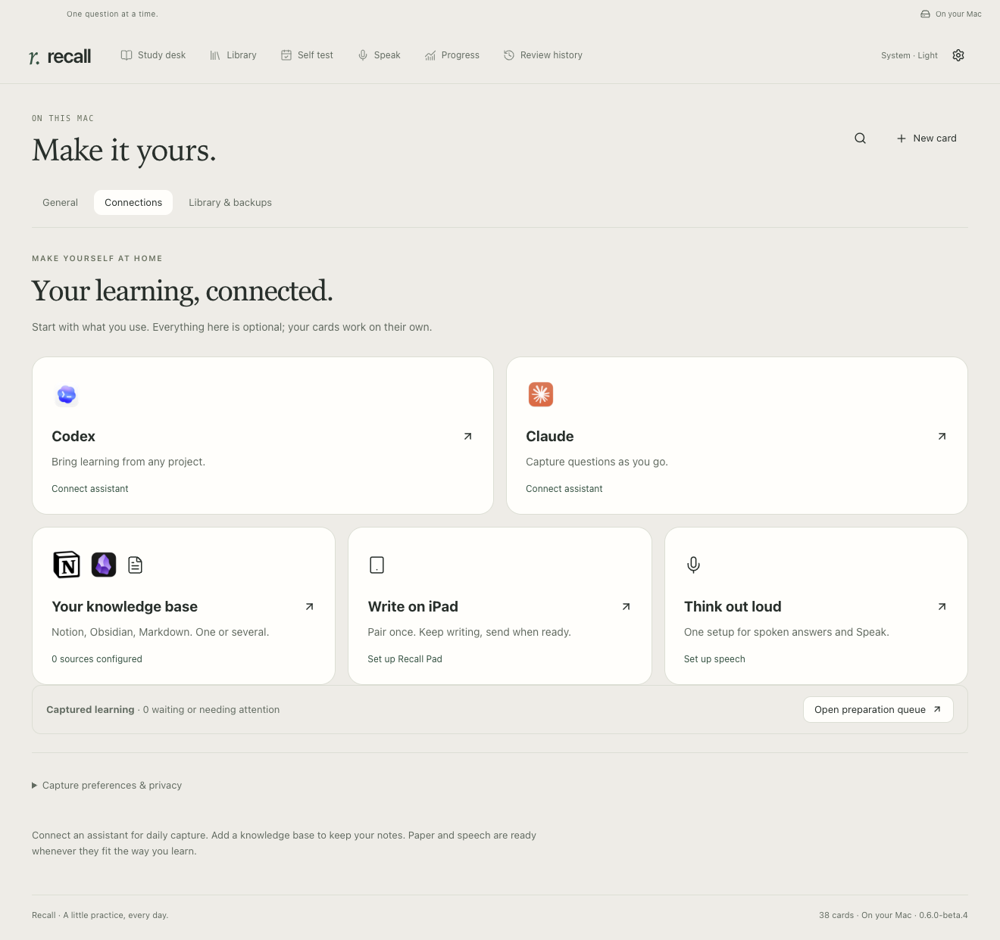
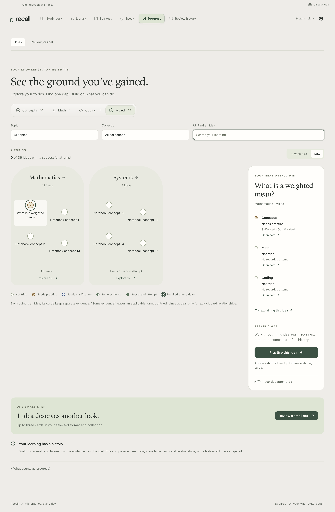

# A quieter learning loop

[Setup](SETUP.md) · [Study walkthrough](demos/STUDY.md)

These controls are in the current source build. Older downloadable releases may show the previous settings tabs until updated.

## Connect what you use

Open **Settings & backups → Connections**. Choose Codex, Claude, your knowledge base, iPad or speech. There is no required order and no Recall account.

- **Assistant:** install the connection, start a fresh chat, then verify that a real learning receipt arrives. CLI sign-in and a learning receipt are separate checks. Open connection details only when you need diagnostics.
- **Knowledge base:** create or connect Notion, Obsidian or Markdown. Multiple destinations are supported. Choose the folder or scope and access before testing it.
- **iPad:** pair Recall Pad once. Paper-session tools are also available inside each assistant’s setup; copying the start prompt does not send it for you.
- **Speech:** save your API key once. Both the compact answer strip and Speak use this setup. Feedback requests remain explicit.

## Prepare without leaving your flow

**Connections → Open preparation queue → Prepare in background** previews up to eight captures. Review the selected context, then start. You can leave settings and study while the app works. Existing ready cards remain available immediately.

The queue uses your chosen assistant account with tools disabled. It resolves one capture at a time and reuses the updated library between items. Ready results enter through Recall’s sole database writer. Independent checks that cannot finish remain visible with **Finish with assistant**. A slow model can still take time; the app does not hide failures or invent completion.

**Stop preparation** cancels the active request and keeps its source. Capture pause stops further work. Interrupted batches never silently retry after restart; preview the remaining items before continuing. Preparation does not start a test, rate cards or change schedules.

Routine authoring verification uses hidden, disposable windows and saved screenshots. Your live app stays on its current card. Unchanged verification can be reused only for the same content, scenarios, runtime and dependencies. [Contributor verification instructions](../skills/recall-source/references/invisible-verification.md)

## See where to practice next

Open **Progress → Atlas**. Topics form regions; select a region to explore its ideas, then select an idea to inspect the evidence and practice its cards. Search works across the selected topics and collection. Larger libraries show six regions at a time and twelve ideas per focused page.

**Concepts, Math, Coding and Mixed stay separate.** A math-only Atlas shows math evidence and starts math-only sessions. Collection and difficulty filters also stay in force. Mixed can show **Some evidence** when a concept has a successful attempt but an applicable math or coding card remains untried. An untried optional Speak explanation does not erase a successful scored review.

Use **A week ago / Now** to replay the evidence recorded by that time. The comparison uses today's available cards and explicit relationships, not a historical library snapshot. Capturing a new idea alone never fills a point. A successful self-rating, linked feedback or exact-revision test result supplies evidence.

| Lane    | What counts                                                                                                                            |
| ------- | -------------------------------------------------------------------------------------------------------------------------------------- |
| Recall  | Scored concept-card ratings. “Recalled after a day+” requires a successful rating at least 24 hours after the previous scored attempt. |
| Explain | Speak feedback tied to that specific Recall card and its saved reference.                                                              |
| Apply   | Math/coding ratings, local exercise tests for the exact exercise revision, or saved handwriting feedback.                              |

An empty point is **not tried**, amber means **needs practice**, a half-filled point means **some evidence**, and a filled point means a **successful attempt**. A ring requires delayed scored recall for every displayed card in the idea. Unclear feedback is labeled **needs clarification**. Inapplicable formats have no card or point. These are evidence labels, not a mastery score; custom/unlinked explanations and assistant conversations are not scored here.

Select an idea to inspect dates, sources and recorded attempts. **Practice this idea** starts up to three of its matching cards; **Review a small set** chooses a small set from the current region and filters, prioritizing gaps. Answers stay hidden and you choose every rating. An unfinished session is preserved; finish it before starting an Atlas session. New background cards never rearrange an active session.

Lines connect explicitly related cards; sharing a topic alone does not imply a dependency. Where an exercise explicitly references multiple parent ideas, a successful exercise result can mark their connection as demonstrated. **Connected ideas** exposes the supporting card. Atlas never invents a cross-concept challenge or awards a connection just for viewing cards.

Your original charts and counts remain under **Progress → Review journal**. Review history is unchanged.
