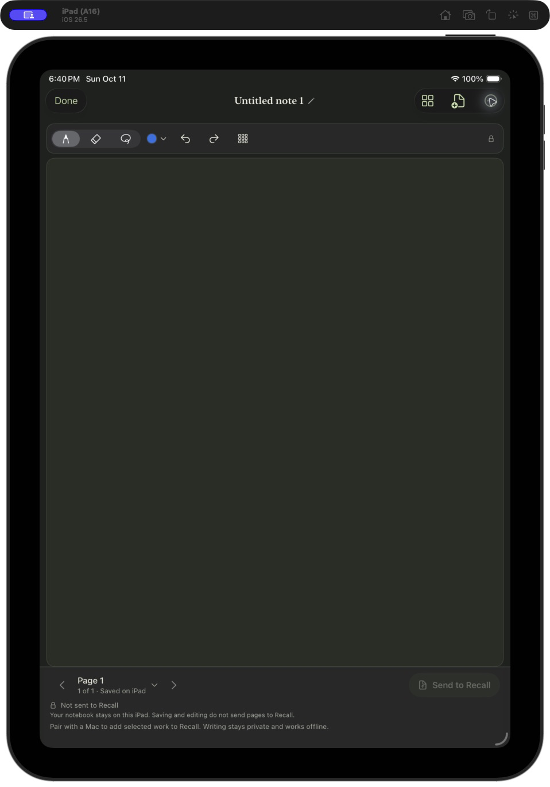
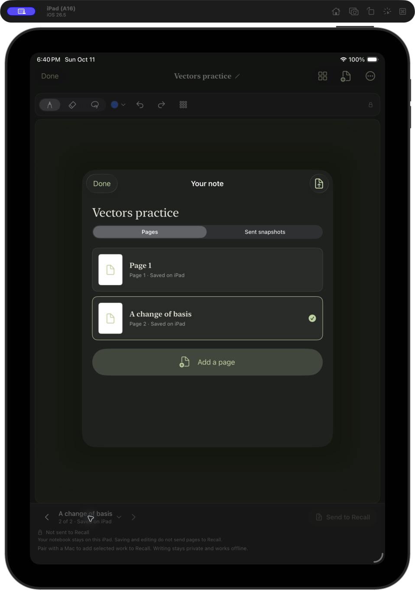
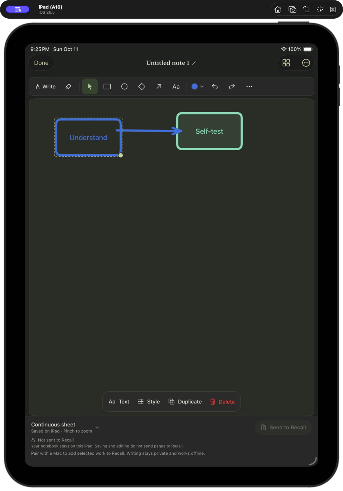
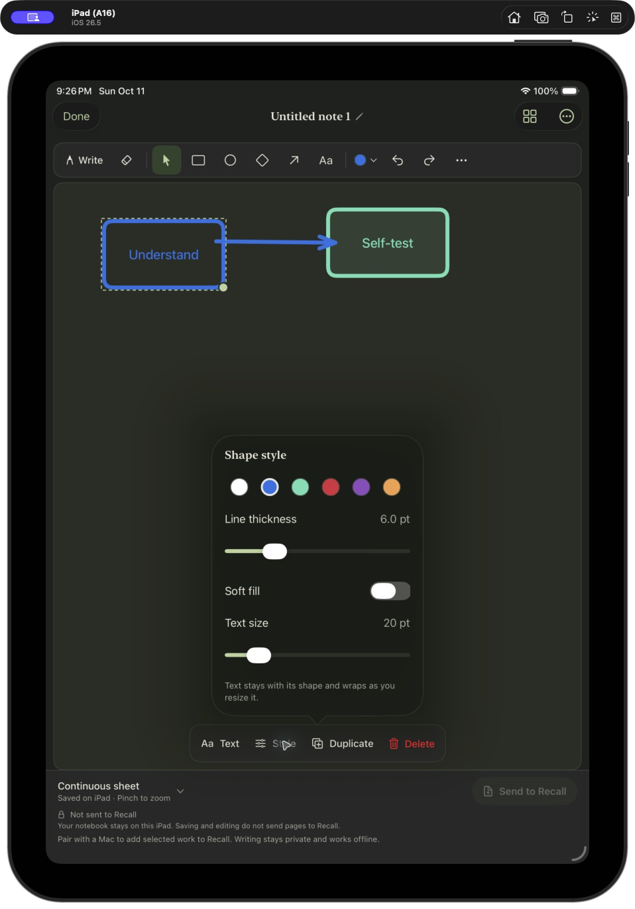
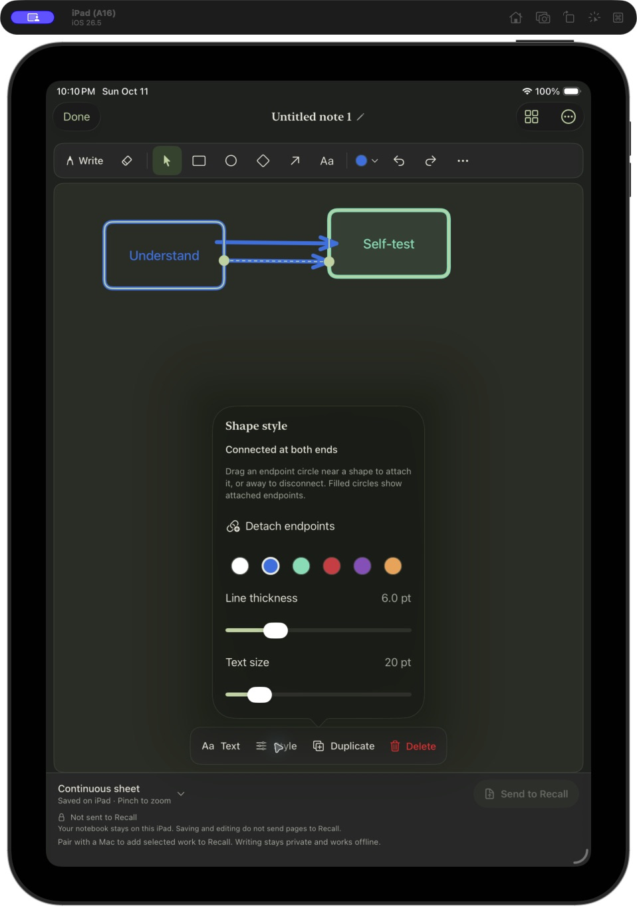
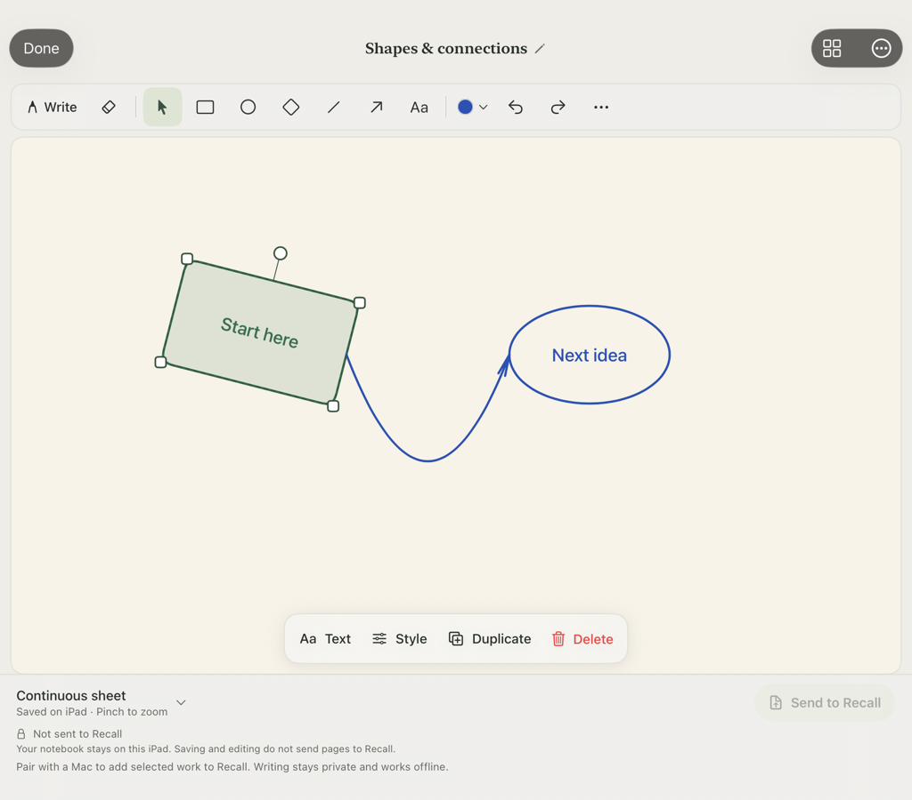
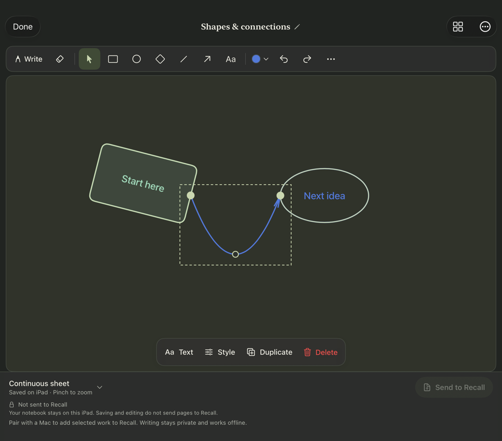

# Your private notebooks

**Simplified writing desk — source build.** Use **New note** directly from Home or **Continue [title]** to resume saved work. Notebooks remains in the toolbar for organization. The editor keeps Write, Erase and Undo at the front of its tool strip; **Shapes** opens the shape/text choices, with object selection and contextual actions retained. **Add to Recall…** opens the same explicit selection preview described below. An inline receipt identifies the last submitted copy and marks newer edits private; **Details** opens Sent snapshots. No storage migration or automatic sharing is introduced, and a new app build is required.

_TestFlight build 7 has been checked on an iPad: continuous writing, scrolling, pinch zoom, editable diagrams, recovery and a multipage notebook transfer to the Mac work. KB/card preparation is a separate, explicit step. Build 7's Send screen can fail to show that a snapshot was saved; see [checking a send](#check-whether-your-work-arrived) before tapping it again._

_Build 9 combines the direct drawing toolbar and clearer Send confirmation. It is available in internal TestFlight and has been installed on the test iPad with existing work present. A disposable-note check confirmed direct shape deletion, Undo restoring the shape and label, Done/reopen recovery, and returning to Pencil writing. Updated Send feedback and VoiceOver still need separate device checks._

_Build 10 is available in internal TestFlight and opens on the test iPad with existing work present. It expands the writable paper when zooming out and adds arrows that attach to shapes. Physical right-edge writing and attached-arrow gestures remain device checks._

The newer Home brings recent sheets and notes together while keeping their storage and sharing separate. **Notebooks** holds personal notes you choose to add to Recall later; older installed builds may still show **Live / Notebooks** tabs. Writing in a notebook never sends it automatically.

## Write first

1. Open **Notebooks → New notebook** and give it a name.
2. Tap **New note** to start writing on a blank **Page 1** immediately. You can name it later by tapping the note title above the canvas.
3. Keep writing and scroll as the sheet grows. Open **Pages** to revisit another sheet or inspect sent snapshots; **Add another sheet** stays available in **More** when you want a separate workspace.
4. Tap **Done** to return to the notebook. Opening the note again resumes the last page you used.

Notebooks organize your notes; tapping a note takes you straight to its writing canvas. Notebooks, notes and editable ink save on the iPad and work offline. Light/dark appearance follows your device. Rename from the title or item menu; swipe or hold an item for deletion options. Deletion asks for confirmation and removes the selected local work, not existing Mac snapshots, cards or KB notes.

_Actual simulator captures from the verified direct-entry source using synthetic notes. They show the canvas and optional Pages tray before the newer diagram tools were added. They do not establish physical Pencil writing or notebook transfer quality._

## Write and diagram on one sheet

A note starts with one continuous vertical sheet. Write with Apple Pencil and scroll with your fingers; pinch to zoom from 35% to 300%. Ink, the paper grid and diagram objects share the same coordinates. Existing multi-page notes remain available through **Pages**.

The source drawing toolbar keeps **Write**, ink **Eraser** and **Undo** first. Open **Shapes** for **Rectangle**, **Circle**, **Diamond**, **Line**, **Arrow** and **Text**; **Select objects** remains beside it. Earlier builds show the individual shape tools directly. Every note opens in **Write**, ready for Pencil ink. Drag with a shape tool to draw an object, or tap with **Text** to place a label. Choose **Select objects** and tap an object to move or resize it; its selection outline and handles show what will change. Tap **Write** to resume handwriting. Use one finger to scroll while writing, or two fingers to scroll and pinch while an object tool is active.

Selecting an object shows a floating action bar along the bottom of the canvas: **Text · Style · Duplicate · Delete**. The bar does not shift the sheet or change its scroll position. To remove a shape, choose **Select objects**, tap the shape, then tap **Delete**. Shape deletion needs no confirmation; **Undo** restores both the object and its attached label. The ink **Eraser** removes handwriting; use **Delete** for diagram objects.

Tap **Text** in the selected-object bar, or double-tap the object, to edit its label. Labels stay editable and move with their shape. **Style** opens six colors, fill for container shapes, line width and text size. Changes are checked against the sheet's geometry and content limits before saving. Changes autosave locally, with a visible saving or retry state if a label cannot be saved. Each sheet supports up to 500 diagram objects and 4,000 characters per label.

Open **More** for the handwriting lasso, paper style and **On this sheet** object list. The list provides another way to select an existing object without finding it on a long sheet. These controls have accessibility labels; physical VoiceOver interaction remains to be checked.

To connect two shapes, choose **Arrow** and drag from inside or near the edge of one rectangle, circle or diamond to another. The arrow snaps to their outlines and follows them when they move or resize. Choose **Select objects** and tap the arrow to show its two endpoint circles: filled circles mean attached ends. Drag an endpoint to another shape to reconnect it, or away from shapes to leave it free. **Style → Detach endpoints** frees both ends explicitly. Deleting a connected shape leaves the arrow at its last position; **Undo** restores the shape and its connection. Previously drawn arrows remain free until you deliberately attach an endpoint.

The compact tool strip, contextual actions and attached endpoints draw on [Excalidraw's official tablet controls](https://github.com/excalidraw/excalidraw/blob/master/packages/excalidraw/components/Actions.tsx) and [connector behavior](https://github.com/excalidraw/excalidraw/blob/master/packages/element/src/binding.ts), [transform handles](https://github.com/excalidraw/excalidraw/blob/master/packages/element/src/transformHandles.ts) and [line editing](https://github.com/excalidraw/excalidraw/blob/master/packages/element/src/linearElementEditor.ts), adapted for native Pencil writing and Recall's appearance. The newer source adds four resize corners, a rotation circle above the selection, and one draggable middle circle for smooth curves. Grab any corner to resize with the opposite corner fixed; grab the top circle to rotate the shape and its text together. For lines and arrows, drag the middle circle to curve them (zoom in if a short line hides its middle handle); **Style → Straighten line** removes the bend. Connected endpoints remain anchored while bending. Detach endpoints before rotating or uniformly resizing a whole connector. **Style** also offers a rotation slider for shapes. These source additions need a new app update and physical gesture checks. Object groups, multiple curve points, loop/elbow routing and Excalidraw file compatibility remain outside the scope.

_Actual simulator captures of the new source interface using synthetic content. Build 7's physical writing, core shape gestures and multipage transfer were separately confirmed; build 9's direct Delete, Undo, label recovery, reopening and return to writing were also confirmed on the iPad. These images remain simulator captures; VoiceOver is a separate check._

_Actual simulator capture of the attached-arrow source update. Creating an attached connector, explicit detachment, Undo and Done/reopen recovery were checked in the simulator. Endpoint dragging and right-edge Pencil writing still need a physical-device check._

Sending renders the selected ink, shapes and labels into ordered images, including offscreen content, while keeping an editable copy. Long sheets may produce several image pages. Export limits still apply: oversized work remains saved rather than being silently shortened. These additions require a new app build; they do not enable automatic capture or sharing.

_Native editor renderings from synthetic simulator test fixtures for the newer rotation/curve source. They verify the layout and selected controls in both appearances, not physical Pencil gestures or a TestFlight installation._

## Send only what you choose

Pair with Recall once using the [iPad setup guide](SETUP.md#pair-once). From the canvas, choose **Add to Recall…** for the current page, or **Add this note to Recall…** from its menu to include the note's written pages. A notebook's menu also lets you send several notes together.

On the selection screen, choose the source sheets and tap **Send selected** once. The thumbnails show each sheet's beginning, not every image that a long sheet will export. Opening this screen alone sends nothing. **Snapshot saved** confirms that an immutable copy is queued; **Received on Mac** confirms that the Mac has stored it. Later writing stays private until you send again.

Sending saves immutable snapshots in an offline outbox. Once the paired Mac is available, they transfer automatically; later notebook edits stay private. Long writing exports as ordered image pages, including offscreen ink. A single note submission supports up to 20 exported pages and 64 MB, including editable drawings. Larger multi-page notes stay saved: select fewer pages and send another part. A very long single sheet can also reach these export limits; its original stays local and the app reports the limit.

Preparing several notes together is all-or-nothing: if any selected note cannot be prepared, none of that new selection is queued, and your originals remain saved. Once prepared, each note has its own transfer and KB/card processing receipt.

### Check whether your work arrived

In TestFlight build 7, the selection screen can stay open without a visible confirmation after **Send selected**, even when the Mac has already received the work. Reopening and sending the unchanged selection creates another snapshot. Close the selection screen and open **Pages → Sent snapshots**, or check **From your notebooks** on the Mac, before trying again.

Review the Mac's ordered images to check the complete exported work. A physical build-7 check confirmed a long sheet arrived as four image pages, including a readable shape label and lower offscreen writing. Receiving those images did not create cards, write KB notes or rate anything. The test snapshot was not submitted for learning preparation.

The newer source UI keeps the saving/receipt panel visible above the selection list. After saving, the action becomes disabled **Saved** and **Done** returns to writing; this screen cannot create another snapshot of the same selection. **Retry this transfer**, when offered, reuses the saved snapshot. The fix is included in installed internal TestFlight build 9; the saving/receipt interaction still needs its own physical-device check.

## Turn those pages into learning

On the Mac, open **Settings & backups → Connections → Open preparation queue → From your notebooks**. Choose **View pages** to inspect the complete ordered snapshot. To prepare learning, choose Codex or Claude and use **Finish with assistant**. There is no need to restart Recall to see newly received work. Copy its prompt into a fresh connected assistant session. This step shares only the selected snapshot with that assistant's provider.

If your assistant was connected before this update, click **Refresh instructions** on its connection once. This installs the latest shared notebook guidance without removing your other instructions. Refresh both connections if you use Codex and Claude.

The assistant reads the pages and searches existing knowledge and Recall objectives. It can deepen an existing KB topic, create a missing concept, reuse cards and add relevant math/coding exercises with the usual validation. It uses your configured KB scopes and authoring permissions. If you have no KB, Recall cards can still be prepared; create one later using [Create my first knowledge base](SETUP.md). Read-only sources, unavailable connectors, unclear handwriting and failed checks are reported separately.

Notebook preparation currently needs this full assistant session: **Prepare next** handles text captures and skips handwritten snapshots. Receipt checks validate snapshot identity, selected-page coverage, card availability and scoped KB record revisions. They do not independently prove an assistant's interpretation of handwriting or a remote Notion read-back.

## Read the status correctly

| Status                                     | What it means                                                                                             |
| ------------------------------------------ | --------------------------------------------------------------------------------------------------------- |
| Waiting for Mac                            | The selected snapshot is saved on the iPad and queued.                                                    |
| Received on Mac / Ready for your assistant | The Mac has saved it; KB/cards have not been completed.                                                   |
| Processing                                 | A submitted result is being applied.                                                                      |
| Added to Recall                            | Validated cards were added or reused for that snapshot; inspect its KB receipts for destination outcomes. |
| Reviewed                                   | The assistant reviewed the snapshot and found no card-worthy learning.                                    |
| Needs attention                            | A transfer, connector, interpretation or validation needs follow-up. Saved work remains available.        |

Notes and notebook covers show the last send and last successful addition separately. Page counts compare current content with completed snapshots. Sending one page never marks an entire notebook current, and later edits show that they have not been added.

These are historical receipts, not a live comparison with the Mac's library. If you restore an earlier Mac backup, send a fresh selection explicitly to establish coverage in that restored library. A restore never reprocesses your notebook automatically.

Selected snapshots and their drawings are included in Mac profile backups. The rest of your private notebook exists only on the iPad; use your normal device backup to protect it. Restoring a Mac backup never starts preparation, API calls or tutor deliveries automatically. Writing, receiving and importing never rate a card or change its review schedule.
