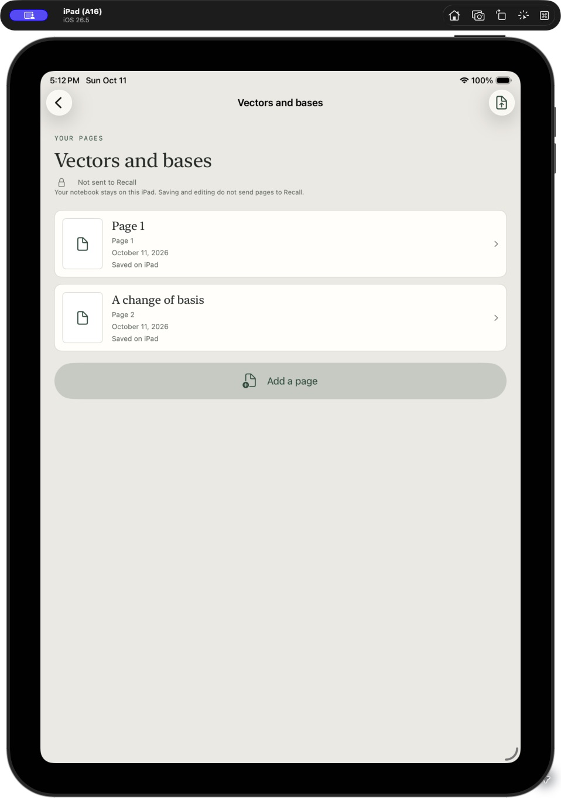

# Your private notebooks

_Available in new source builds; the previously published Mac release and TestFlight build 4 do not include notebooks yet._

Recall Pad has two spaces: **Live** for Recall Study and your tutor conversation, and **Notebooks** for personal notes you choose to add to Recall later. Writing in a notebook never sends it automatically.

## Write first

1. Open **Notebooks → New notebook** and give it a name.
2. Add a note and open **Page 1**. Write with Apple Pencil using the same pen colors, thickness, eraser and paper styles as your live sheets.
3. Tap **Done** to return to the note. Add more pages as needed.

Notebooks, notes and editable ink save on the iPad and work offline. Light/dark appearance follows your device. Rename from the item menu; swipe or hold an item for deletion options. Deletion asks for confirmation and removes the selected local work, not existing Mac snapshots, cards or KB notes.

_Actual iPad simulator screen with synthetic notes. [Dark appearance](images/setup-notebooks-dark.png). Real Apple Pencil writing and transfers still require device verification for this update._

## Send only what you choose

Pair with Recall once using the [iPad setup guide](SETUP.md#pair-once). In a note, choose **Send to Recall**, select pages and confirm. A notebook's menu also lets you send several notes together. Preview clearly shows what is selected.

Sending saves immutable snapshots in an offline outbox. Once the paired Mac is available, they transfer automatically; later notebook edits stay private. Long writing exports as ordered image pages, including offscreen ink. A single note submission supports up to 20 exported pages and 64 MB, including editable drawings. Larger notes stay saved: select fewer pages and send another part. Notebook-wide sending reports per-note failures rather than hiding them behind one success badge.

## Turn those pages into learning

On the Mac, open **Settings & backups → Learning connections → From your notebooks**. Review the received pages, choose Codex or Claude, and use **Finish with assistant**. Copy its prompt into a fresh connected assistant session. This step shares only the selected snapshot with that assistant's provider.

If your assistant was connected before this update, click **Refresh instructions** on its connection once. This installs the latest shared notebook guidance without removing your other instructions. Refresh both connections if you use Codex and Claude.

The assistant reads the pages and searches existing knowledge and Recall objectives. It can deepen an existing KB topic, create a missing concept, reuse cards and add relevant math/coding exercises with the usual validation. It uses your configured KB scopes and authoring permissions. If you have no KB, Recall cards can still be prepared; create one later using [Create my first knowledge base](SETUP.md). Read-only sources, unavailable connectors, unclear handwriting and failed checks are reported separately.

Notebook preparation currently needs this full assistant session: **Prepare next** handles text captures and skips handwritten snapshots. Receipt checks validate snapshot identity, selected-page coverage, card availability and scoped KB record revisions. They do not independently prove an assistant's interpretation of handwriting or a remote Notion read-back.

## Read the status correctly

| Status                                     | What it means                                                                                             |
| ------------------------------------------ | --------------------------------------------------------------------------------------------------------- |
| Waiting for Mac                            | The selected snapshot is saved on the iPad and queued.                                                    |
| Received on Mac / Ready for your assistant | The Mac has saved it; KB/cards have not been completed.                                                   |
| Processing                                 | A submitted result is being applied.                                                                      |
| Added to Recall                            | Validated cards were added or reused for that snapshot; inspect its KB receipts for destination outcomes. |
| Reviewed                                   | The assistant reviewed the snapshot and found no card-worthy learning.                                    |
| Needs attention                            | A transfer, connector, interpretation or validation needs follow-up. Saved work remains available.        |

Notes and notebook covers show the last send and last successful addition separately. Page counts compare current content with completed snapshots. Sending one page never marks an entire notebook current, and later edits show that they have not been added.

These are historical receipts, not a live comparison with the Mac's library. If you restore an earlier Mac backup, send a fresh selection explicitly to establish coverage in that restored library. A restore never reprocesses your notebook automatically.

Selected snapshots and their drawings are included in Mac profile backups. The rest of your private notebook exists only on the iPad; use your normal device backup to protect it. Restoring a Mac backup never starts preparation, API calls or tutor deliveries automatically. Writing, receiving and importing never rate a card or change its review schedule.
