# Set up your Recall

[Documentation](README.md) · [Troubleshooting](TROUBLESHOOTING.md) · [Advanced reference](SETUP_REFERENCE.md)

**A study desk for what you want to remember.** Start with a few cards, then add the connections that fit how you learn.

Only the Mac installation is required. You can study without an account, knowledge base, assistant or API key.

**Your first visit:** [Install](#install-and-open-recall) → [try one short session](#try-your-first-cards). You can stop there.

**When you're ready:** [keep notes](#choose-a-home-for-your-knowledge) · [capture from an assistant](#learning-capture) · [speak](#optional-voice-and-feedback) · [write on iPad](#optional-ipad-companion). [Updating an existing app?](#update-an-existing-installation)

This guide uses the current Mac interface. If a button is missing, update Recall first. Older screenshots may show **Library** for **Card Deck**, or **Learning connections** for **Connections**.

## Install and open Recall

**You need:** an Apple Silicon Mac running macOS 13 or later and internet to download the app. Intel Macs and other operating systems do not have a verified installation path.

<a id="keep-recall-in-applications"></a>

### Download, move, open

1. Open [Recall's GitHub Releases](https://github.com/justslee/recall/releases) and download the **Mac app ZIP** under the newest release's **Assets**. Choose the `macos-arm64` file; GitHub's **Source code** ZIP is for developers.
2. Unzip the download in Finder and move **Recall.app** to **Applications**.
3. Open **Recall.app from Applications** and confirm macOS's first-open prompt. Keep this as its permanent location before connecting assistants.

The download is signed and notarized. Its runtime and iPad discovery helper are included; you do not need Node, Terminal or Xcode for ordinary Mac use. Opening the installed app also enables **Open in Recall** links from your assistant. If macOS reports a damaged app or an unidentified developer, stop and use [installation help](TROUBLESHOOTING.md#the-downloaded-app-will-not-open); do not disable Gatekeeper.

<details>
<summary>Prefer to build from source?</summary>

Install **Node 24 or later** using the [official macOS installer](https://nodejs.org/en/download); it includes npm. Recall checks Node but does not install it. Download the repository's **Code → Download ZIP** and unzip it, or clone it with Git.

In a new Terminal window, type `cd `, drag the source folder into Terminal, and press Return. Run these commands one at a time:

```sh
npm run setup -- --no-launch
npm run package
```

Let each command finish before starting the next. Then copy **release → Recall-darwin-arm64 → Recall.app** into Applications and open it there. Keep Node and the source folder if you want to build future updates. A local source build does not inherit the publisher's signing or notarization. [Detailed source setup](SETUP_REFERENCE.md#install-and-open-recall) · [Setup help](TROUBLESHOOTING.md#setup-stops-before-installing)

</details>

## Try your first cards

Your empty study desk offers three starting points:

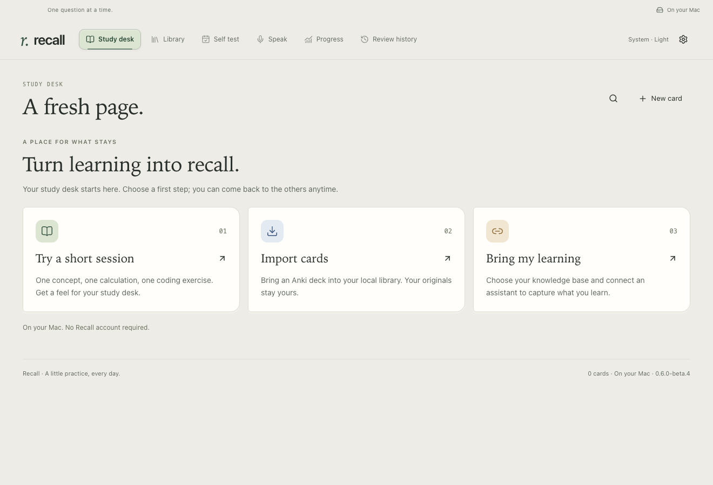

| Action                  | What it does                                                                                       |
| :---------------------- | :------------------------------------------------------------------------------------------------- |
| **Try a short session** | Adds three original sample cards: a concept, a calculation and a coding exercise.                  |
| **Import cards**        | Opens Anki import in **Card Deck**. Your original deck stays unchanged; inspect the import report. |
| **Bring my learning**   | Opens settings for your knowledge sources and assistants. You can do this later.                   |

<details>
<summary>Bringing cards from Anki?</summary>

Import a compatible **.apkg** package containing the older `collection.anki2` format. Basic Front/Back cards are the supported starting point. Some previously reviewed or unsupported cards are kept as drafts for inspection. This beta does not extract Anki archive media or convert Anki schedules into Recall’s review history; keep your original deck and inspect the report before studying.

</details>

Choose **Try a short session** for a first look. Existing libraries open directly without this welcome screen.

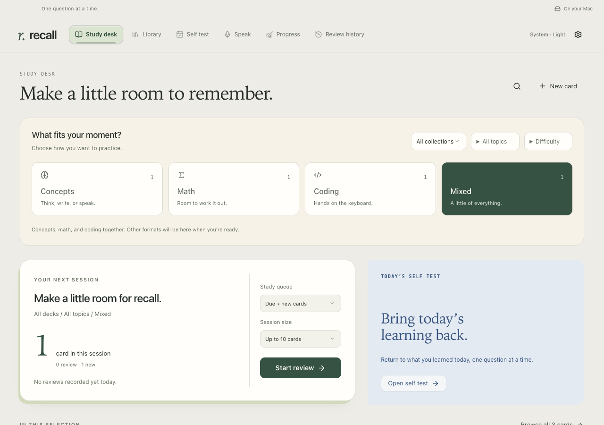

On **Study desk**, choose a collection or topic and a study format: **Concepts**, **Math**, **Coding** or **Mixed**. You can keep a session to concepts when you have no paper or time for code.

Start a review. Answer from memory, then **Flip card** or reveal the worked solution. Choose **Again**, **Hard**, **Good** or **Easy** yourself; that rating schedules the next review. Solutions stay hidden until you choose to see them. Interactive explanations appear on cards where they help.

**Card Deck** is where you browse, search, edit and import. **Progress** and **Review history** reflect your actual study. [Study walkthrough →](demos/STUDY.md)

### Optional coding runtimes

Concept and math study need no additional tools. Running Python or C++ exercises may require Apple’s Command Line Tools; some scientific Python exercises need a separate environment. Follow the [coding runtime instructions](SETUP_REFERENCE.md#optional-coding-runtimes) when you want to run those cards. Nothing downloads just because you open a coding card.

## Choose a home for your knowledge

**The simplest choice is a local Knowledge space in Recall.** You do not need Notion, Obsidian or an assistant to write and find notes.

1. Open **Knowledge → Create a space** and choose where its folder will live.
2. Choose **New note**, write, then press **⌘S**. Switch to **Read** for the formatted page.
3. Use **⌘K** to find it again. In a note's practice panel, use linked cards or **Prepare with assistant** to request questions from that note.

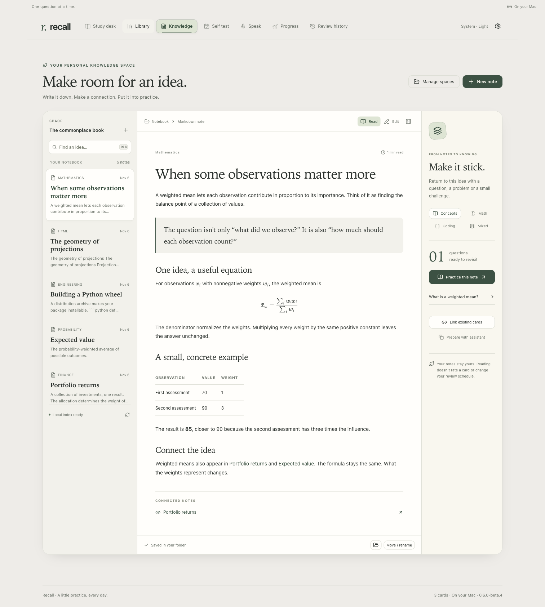

Your Markdown and HTML files remain in the folder you chose. Saving a note does not automatically create cards. [Knowledge walkthrough →](KNOWLEDGE_SPACE.md)

### Prefer Markdown, Obsidian or Notion?

Open **Settings & backups → Connections → Your knowledge base**. Choose one primary home; add mirrors only if you need them. Recall and Obsidian can use the **same local folder**, with no duplicate copy to synchronize. Notion access goes through your assistant's Notion connector.

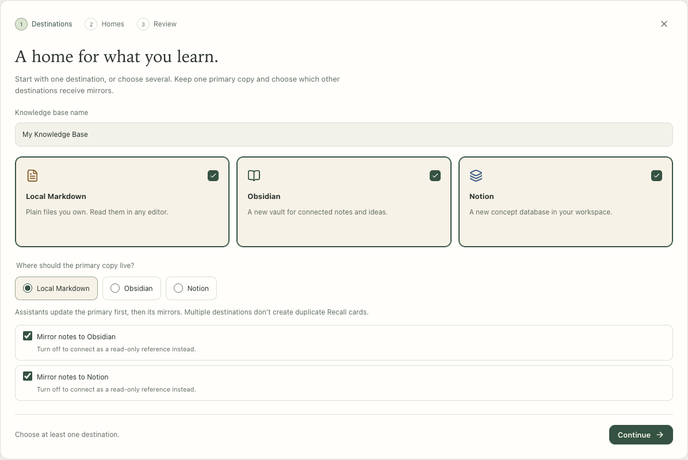

### Create your first knowledge base

For an assistant-managed setup, including multiple destinations:

1. Choose **Create my first knowledge base**. With sources already connected, the button is **Create knowledge base**.
2. Select **Local Markdown**, **Obsidian**, **Notion**, or several of them.
3. Pick **one primary home**. Choose **Mirror notes to…** for the additional destinations you want the assistant to update; leave it off for a read-only reference.
4. Choose the homes: a parent folder and a new folder name locally, or an accessible parent page in Notion.
5. Choose **Review creation**, inspect the plan, then select **Let my assistants build this knowledge base → Create knowledge base**.

| Your choice        | What to expect                                                                                           |
| :----------------- | :------------------------------------------------------------------------------------------------------- |
| **Local Markdown** | Recall creates a notes folder you can open in any Markdown editor. No other app is needed.               |
| **Obsidian**       | Recall creates a local vault folder. Install Obsidian separately and use **Open folder as vault**.       |
| **Notion**         | Your connected assistant creates the database through its Notion connector. Finish the extra step below. |

**For Notion:** connect your assistant as described in the next section, ensure its Notion connector can access the chosen parent, then choose **Finish Notion with assistant → Copy setup prompt**. Paste it into a fresh assistant chat. After it creates and reads back the new database, choose **Refresh setup** in Recall. Selecting a Notion URL alone does not verify live access; Recall has no separate Notion login or token field.

### Use notes you already have

Choose **Add knowledge source**, select Markdown, Obsidian or Notion, then choose the exact notes folder or Notion scope. For an existing Obsidian vault, select its KB folder rather than creating a second vault inside it.

Choose **Read-only** if the assistant should consult notes. Choose **Scoped authoring** if it may create or update notes there. Select **Test connection**, inspect the result, then **Save source**. A Notion check also needs a real assistant connector request.

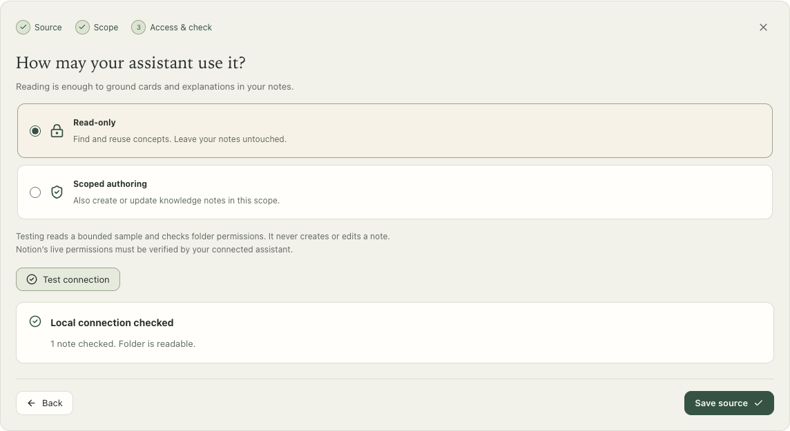

Your primary is the source of truth; mirrors receive the same concepts after a verified primary write. These roles guide the assistant rather than running continuous two-way sync. Creating or connecting a KB does not enable learning capture or create flashcards by itself. [Knowledge base guide →](KNOWLEDGE.md)

## Learning capture

**Optional.** Connect the assistants you use so meaningful learning can reach Recall from other local projects, too.

Open **Settings & backups → Connections → Codex or Claude**.

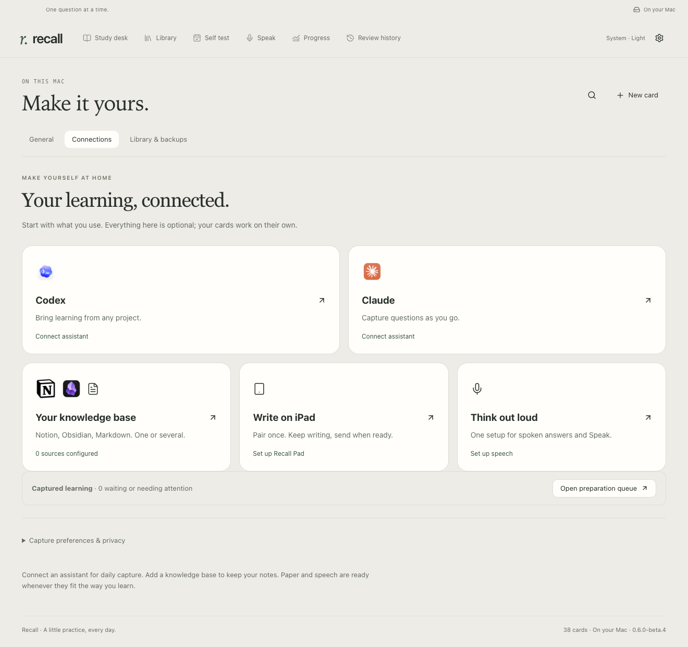

1. Choose **Connect** for Codex, Claude Code, or both. Review the installation plan, then choose **Install connection**.
2. Return to **All connections → Capture preferences & privacy**. Select **Allow learning capture from my configured skills**. Check **Learning date & privacy** for your timezone, then choose **Save learning settings**.
3. Start a **fresh assistant chat** so it loads the installed instructions.
4. Return to the assistant’s tile. Choose **Verify learning → Create verification prompt → Copy prompt** and use that prompt in your fresh chat. **Readiness & connection details → Check readiness** provides diagnostics if needed.
5. Check Recall for the learning receipt. **Learning verified** confirms that the verification reached this library.

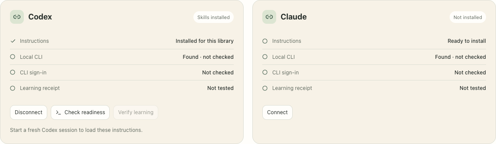

**Skills installed** means setup files are present. CLI readiness and a learning receipt are separate checks. If sign-in needs attention, use [connection troubleshooting](TROUBLESHOOTING.md); do not assume the receipt exists from the badge alone.

Now ask questions as you read or work. **The answer comes first.** The assistant makes a short local capture, reusing ready cards where they match and queuing missing objectives for later preparation. It does not need to update Notion, write a long note or build a new card before answering.

Try: **“Explain this with an example, and capture the key idea for Recall.”** For a durable note, ask **“Save this explanation to my primary knowledge base.”** Say **“Don't capture this discussion”** to opt out.

When ready, ask **“Prepare today's Recall Self Test from captured learning.”** Preparation creates and validates missing cards separately, considering math or code only when useful. **Pending** means captured, not ready to study. Routine operations are excluded; capture never establishes mastery.

Open **Self Test** to review a learning day. Use **Study desk** for cards due for another spaced review. You can revisit earlier days. If a captured objective is blocked, use **Finish with assistant**; **Retry** is useful after a temporary failure is resolved. Optional catch-up scans and daily scheduling are separate choices, not automatically enabled by installation. [Daily learning walkthrough →](demos/LEARNING.md)

## Optional voice and feedback

Open **Settings & backups → Connections → Think out loud** if you want dictation and answer evaluation, or explanation practice in **Speak**.

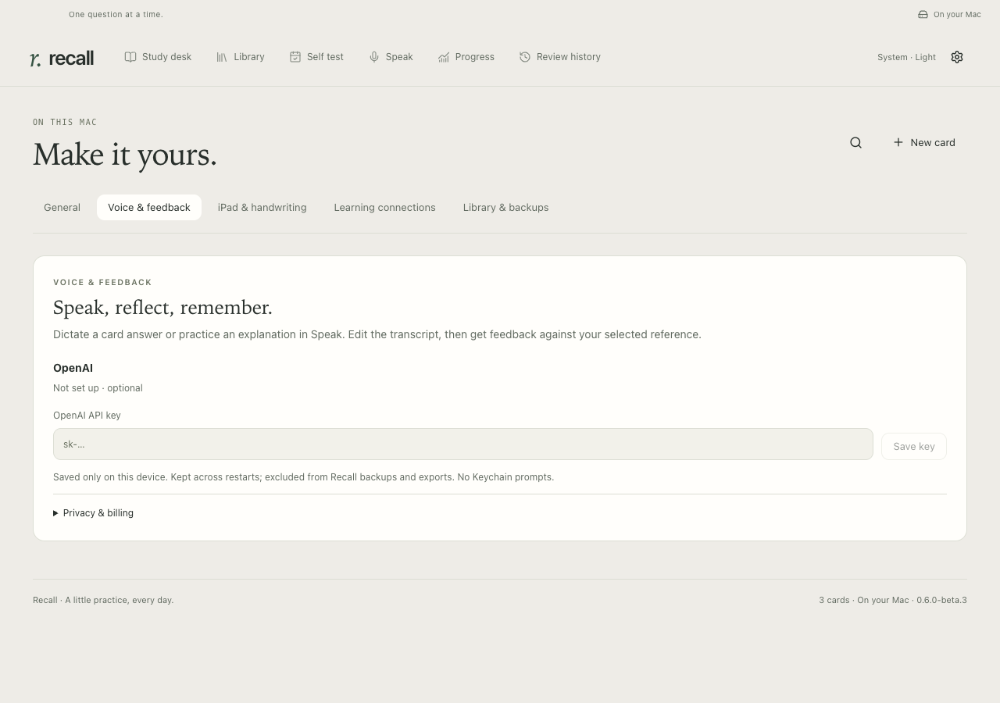

Enter your own **OpenAI API key → Save key**. Recall keeps it on this device across restarts, outside library exports and backups. It uses a local owner-only file without Keychain prompts; see [credential storage](PRIVACY.md#api-key-storage) before deciding whether to save it.

Then choose where to practice:

- **A short card answer:** use the card's **Speak / Type** strip, edit the transcript, then request feedback against its reference.
- **A longer explanation:** open **Speak**, choose a card/note or **Your own topic**, set the audience, and explain it. A reference enables accuracy feedback; without one, accuracy is not assessed.

This is separate from a ChatGPT subscription: API billing and internet are required for these features. Recording sends audio to OpenAI; Recall saves no audio. You can edit the transcript before requesting feedback. Feedback does not rate the card for you. [Speak walkthrough →](demos/SPEAK.md) · [Voice reference →](VOICE.md)

## Optional iPad companion

**Recall Pad is a separate native iPad app**, for iPadOS 17 or later and Apple Pencil. **Invited testers:** install [Apple's TestFlight](https://testflight.apple.com/), open your invitation on the iPad, and choose **Install** for Recall Pad. There is no public beta invitation yet. No Xcode or personal signing account is needed for TestFlight.

You can also [build and install Recall Pad through Xcode](IPAD_NATIVE.md). The published Mac app already includes its discovery helper; source users can follow the [helper build steps](SETUP_REFERENCE.md#optional-ipad-companion). You can leave this entire section for later.

### Pair once

After installing Recall Pad:

1. Connect your Mac and iPad to the same local network and open both apps.
2. On the Mac, open **Settings & backups → Connections → Write on iPad** and select **Enable companion → Pair an iPad**.
3. On the iPad, choose **Pair with Mac → Scan pairing QR code**. Allow camera and local-network access when requested.
4. Scan the Mac’s code and choose **Pair this iPad** on the Mac to approve it.

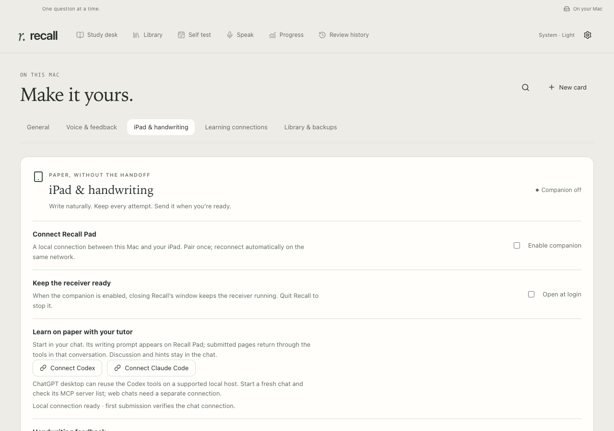

Normal restarts and updates keep the pairing. Your iPad can save work offline; reopen Recall Pad when the Mac is available to transfer it. Keep Recall running to receive pages. Closing its window leaves the enabled companion running; explicitly quitting Recall stops it.

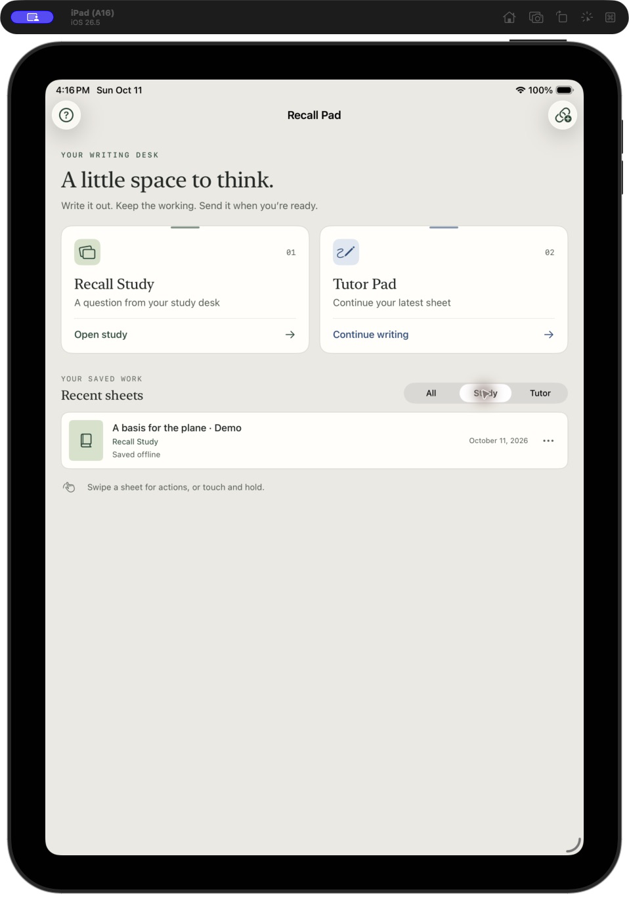

_The native iPad app, shown in a simulator before pairing. It follows your iPad’s light or dark appearance._

### Choose the right writing flow

| I want to…                  | Start here                                                                                   | Where my work goes                                                                                                                                      |
| :-------------------------- | :------------------------------------------------------------------------------------------- | :------------------------------------------------------------------------------------------------------------------------------------------------------ |
| **Answer a Recall card**    | On the Mac, open a concept or math card → **Write on iPad**.                                 | **Send for feedback** saves the attempt in Recall. Assessment uses your OpenAI API key and consent; you reveal the solution and rate the card.          |
| **Work with my chat tutor** | In a connected Codex chat, start a paper-learning session; open its prompt in **Tutor Pad**. | **Send to tutor** makes the pages available to that same chat. Your assistant account handles tutoring; Recall needs no separate API key for this flow. |
| **Keep personal notes**     | In Recall Pad, choose **New note** or open **Notebooks**.                                    | Work stays private on the iPad. **Add to Recall…** sends only the snapshot you select, for later preparation.                                           |

The first two flows are live practice. Notebooks are your own notes; writing in them does not automatically update a knowledge base or create cards.

### Learn on paper in your assistant chat

In **Connections → Codex or Claude → Use … with Recall Pad**, connect the paper tools. They are also available in **Write on iPad → Learn on paper with your tutor**. If already installed, the button says **Refresh … tools**. These paper tools are separate from learning-capture connections.

Start a fresh chat and ask:

> Start a paper-learning session for linear algebra. Give me one problem to solve on my iPad.

Open **Tutor Pad** on the iPad, write your steps, then choose **Send to tutor**. If the assistant is no longer waiting, say **“Check my paper.”** Your discussion, hints and feedback stay in that conversation. The tools read submitted images when invoked; sending a page does not attach it to a chat draft, send a chat message or wake an idle assistant.

Start with Codex for the connected-chat beta, and check one submitted page before a longer session. Claude and ChatGPT have separate compatibility checks; installing their tools alone does not prove image delivery. For any unsupported chat, use the manual route below. [Paper learning and compatibility →](PAPER_LEARNING.md)

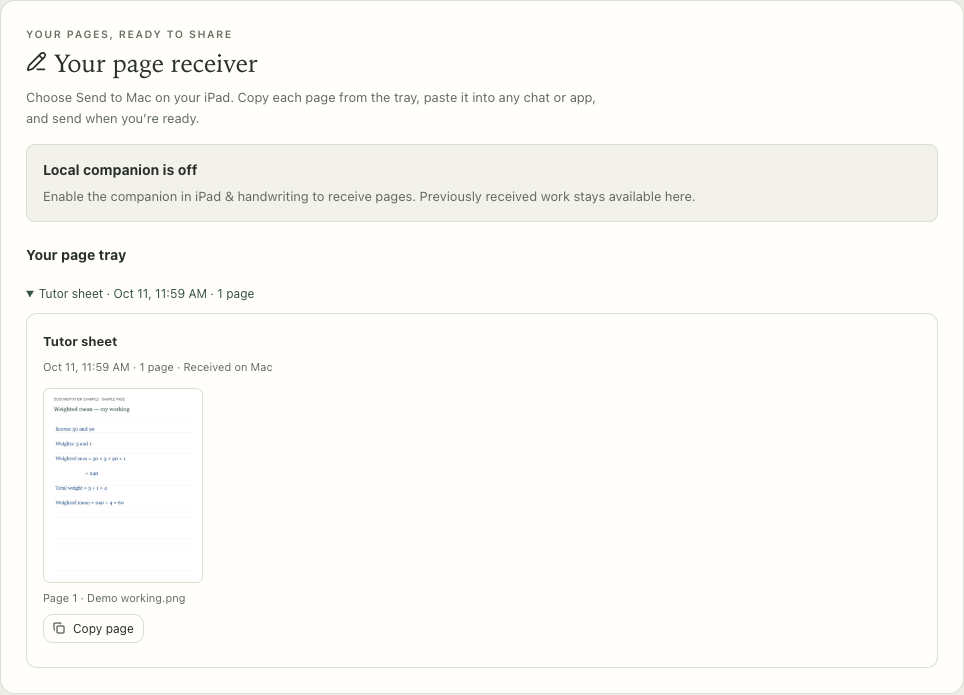

**Manual fallback:** on the Mac, open **File → Tutor Pad → Start receiving pages**. On the iPad, use a blank Tutor Pad sheet and tap **Send to Mac**. In the Mac tray, choose **Copy page**, then paste with **⌘V** into any chat. Review the attachment and press Send yourself. This needs no Accessibility access or timed handoff. PNG/PDF export and sharing are also available on the iPad.

### Keep private notebooks

Open **New note** to start writing immediately; name it at the top when convenient. Use **Notebooks** to organize your notes. To share selected work, choose **Add to Recall…** (called **Send to Recall** in older builds), inspect the selection, then **Send selected**.

**Received on Mac means saved, not converted into notes or cards.** On the Mac, open **Connections → Open preparation queue → From your notebooks → View pages** to see what arrived. Use **Finish with assistant** to prepare the selected snapshot. Later iPad edits stay private until you submit again. [Notebook walkthrough →](NOTEBOOKS.md)

## Update an existing installation

### Update inside Recall

Available in Mac v0.6.0-beta.10 and later. Older apps can use the assistant or manual steps below once to install the version containing this button.

1. Finish any recording, evaluation, coding run or paper transfer.
2. Open **Settings & backups → General → Recall updates → Check for updates**.
3. Choose **Update & restart**. Recall downloads and verifies the published app, replaces it at the existing path, and reopens the same learning profile. Download progress stays visible; you can cancel before installation starts.

Existing Codex/Claude connections refresh after restart. Start fresh assistant chats to load their updated instructions. A connection that changed ownership or paths is preserved and flagged for attention. One previous app remains for recovery; superseded managed copies and downloads are removed. The updater never deletes learning profiles or restores an older learning database.

**Have a source clone too?** Under **Also update my source code**, choose your existing `justslee/recall` repository once. The update action also fetches the latest `main` and advances a clean checkout. It does not reset local changes, switch branches, run Git hooks, install dependencies or build source. A dirty, diverged or custom checkout stays unchanged with a separate message; the signed app can still update. The source branch can contain changes beyond the published release. Source ZIP folders and running development copies retain the manual workflow below.

Updates run only when requested. No automatic installation, GitHub sign-in or separate Node runtime is required. Apps running from a disk image or macOS temporary download location must first be moved into Applications.

### Update with an assistant

Install the public [`recall-upgrade`](../skills/recall-upgrade/SKILL.md) folder through your assistant's skill installer or the Recall plugin, then start a fresh chat. For example, ask Codex **“Install the recall-upgrade skill from justslee/recall, path skills/recall-upgrade.”** Recall also installs it globally when connecting Codex or Claude Code in **Connections**. An existing unrelated skill with the same name is preserved.

Ask **“Use recall-upgrade to update Recall.”** The skill uses the installed app's bundled runtime, so no separate Node installation or GitHub login is needed. It follows the installed release channel: stable installations use stable releases; beta installations include published betas. A version-check request only checks. An explicit upgrade request downloads and verifies the official ZIP, quits Recall gracefully when replacement is needed, replaces it at the same path, and reopens it. A same-version build may need one download before its build number can be confirmed.

The helper checks the checksum, signed publisher, Apple Silicon architecture and notarization. It preserves newer local builds, retains one previous **app** in a private directory beside the installation, and cleans its superseded app and temporary download after successful replacement. Interrupted replacements reconcile on the next upgrade attempt. Unknown or changed saved files are retained for review. Learning profiles, reviews, notes, handwriting, credentials and their backups are outside the upgrade transaction; an app rollback never restores an older learning database.

Finish active recordings or evaluations before requesting an upgrade. Refresh previously connected assistant instructions from the updated app when needed. This skill is an explicit update action, not an unattended background updater. Current support is Apple Silicon macOS.

### Update manually

1. Back up from **Settings & backups → Library & backups**, finish recordings or evaluations, then **Quit Recall**. Closing its window may leave the iPad receiver running.
2. Download the newest **Mac app ZIP** from [GitHub Releases](https://github.com/justslee/recall/releases). Put the ZIP in an empty folder before unzipping it, so Finder can extract it as **Recall.app**.
3. Move **Recall.app** into the **same Applications location** as your installed copy, choose **Replace**, and open it again. If Finder extracted **Recall 2.app**, move that copy to an empty folder and rename it **Recall.app** before moving it into Applications.

Your library lives separately from the source folder. Replacing the app preserves cards, review history, drafts and configuration; do not delete its data folder or reimport your library to update. New cards appear while Recall is open and do not require an app restart.

For Git checkouts, custom profiles or detailed ZIP steps, use [the update reference](SETUP_REFERENCE.md#update-an-existing-installation).

### Update Recall Pad

Save your open sheet with **Done**, then open **TestFlight → Recall Pad → Update** on the iPad. You can enable **Automatic Updates** under **App Information** on its TestFlight page. Apple makes each beta build available for up to 90 days; TestFlight shows its remaining time. [Apple's TestFlight guide](https://testflight.apple.com/)

Update the existing app rather than deleting it: sheets are stored locally on the iPad. Normal updates preserve sheets and pairing; export important work before a significant upgrade. If either app asks for a newer companion, update both apps, then reopen them on the same network. Xcode users should rebuild and install with the same bundle identifier. [Native update reference](IPAD_NATIVE.md#updating-an-existing-development-installation)

### Refresh assistant instructions

When an update changes assistant skills, or you move Recall, refresh its learning connections and paper tools from the updated app, then start fresh assistant chats. [Learning connection refresh steps](SETUP_REFERENCE.md#refresh-assistant-instructions) · [Paper tools](PAPER_LEARNING.md#connect-the-tools)

---

**Ready to learn?** Pick a short [study](demos/STUDY.md), [daily learning](demos/LEARNING.md), [Speak](demos/SPEAK.md) or [paper](demos/PAPER.md) walkthrough. Add connections only when they help your routine.

[Daily workflow](WORKFLOW.md) · [Troubleshooting](TROUBLESHOOTING.md) · [Advanced setup reference](SETUP_REFERENCE.md)
