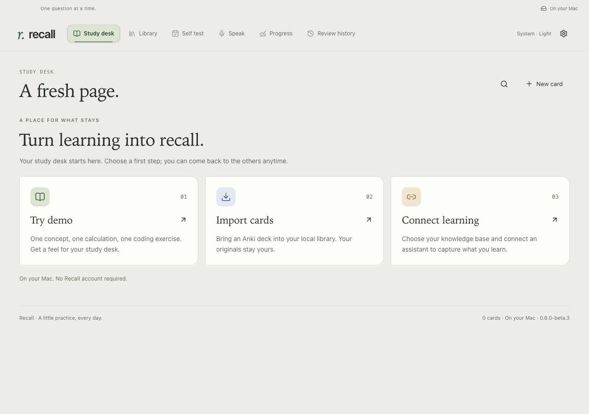
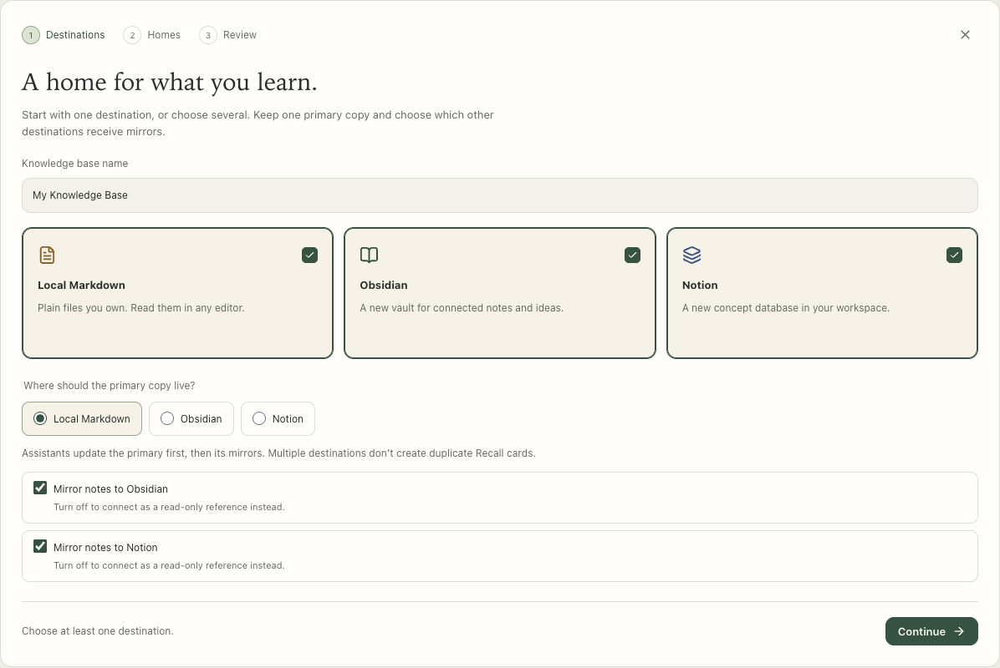
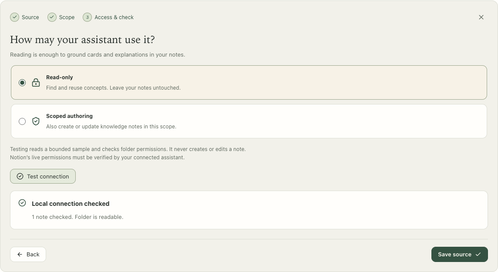
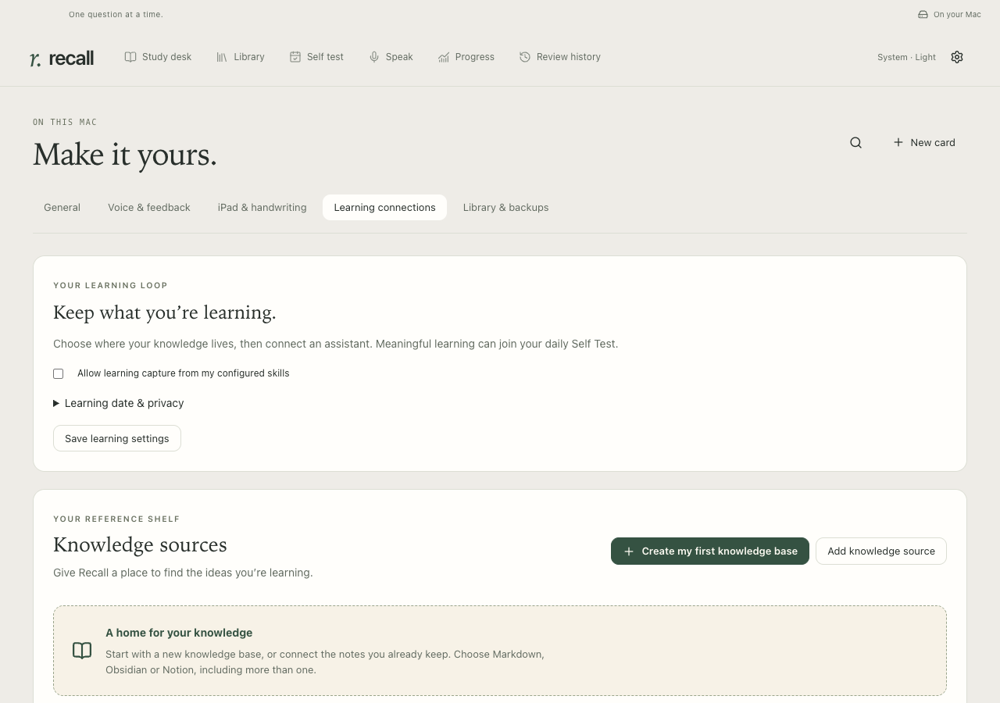
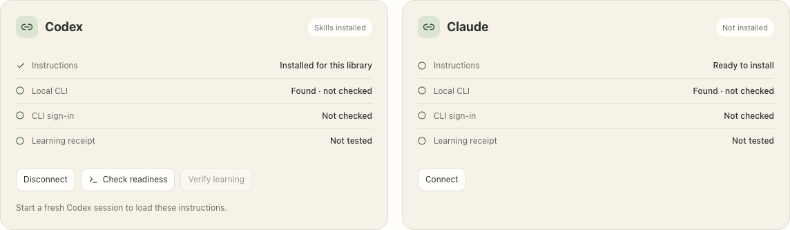
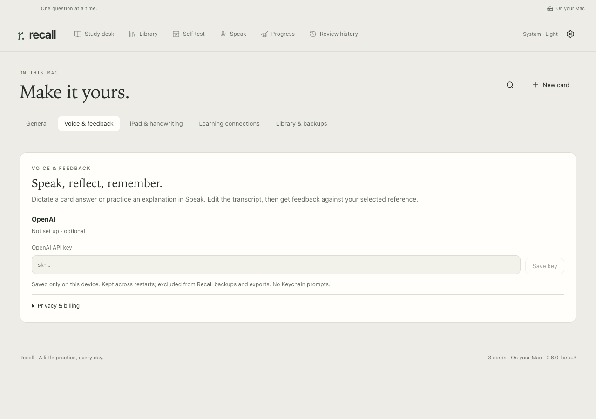
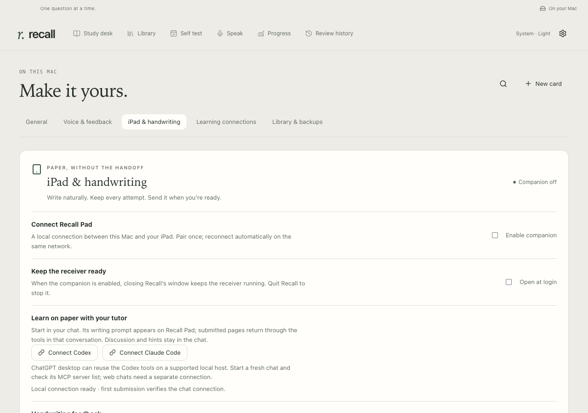
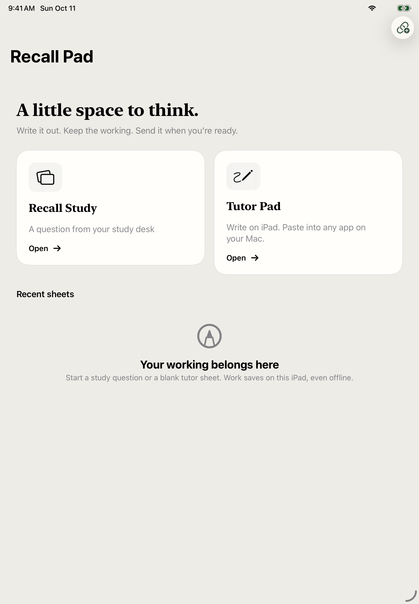
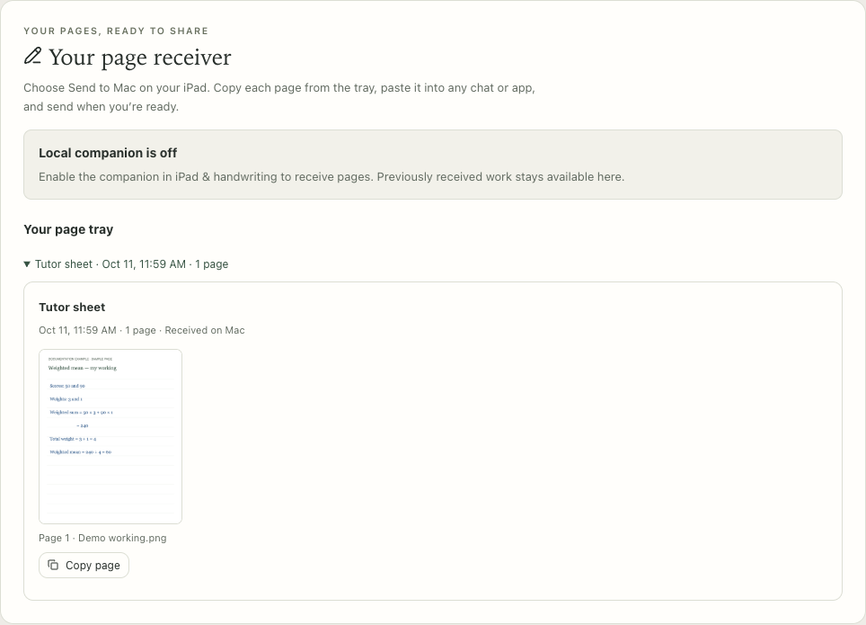

# Set up your Recall

[Documentation](README.md) · [Troubleshooting](TROUBLESHOOTING.md) · [Advanced reference](SETUP_REFERENCE.md)

**A study desk for what you want to remember.** Start with a few cards, then add the connections that fit how you learn.

Only the Mac installation is required. You can study without an account, knowledge base, assistant or API key.

| Start here                                                                                 | Add when you want it                                                                                                                                                     |
| :----------------------------------------------------------------------------------------- | :----------------------------------------------------------------------------------------------------------------------------------------------------------------------- |
| [Install Recall](#install-and-open-recall) → [Try your first cards](#try-your-first-cards) | [Knowledge base](#choose-a-home-for-your-knowledge) · [Assistant learning](#learning-capture) · [Voice](#optional-voice-and-feedback) · [iPad](#optional-ipad-companion) |

## Install and open Recall

**You need:** an Apple Silicon Mac running macOS 13 or later, internet for setup, and Node 22.18 or later. Node 22 is the tested baseline. This is a source-build beta; a signed, notarized download is not available yet. Intel Macs and other operating systems do not have a verified installation path.

### 1. Download Node and Recall

1. Install Node using the [official macOS installer](https://nodejs.org/en/download). It includes npm, the tool used by the commands below. Recall does not install Node for you.
2. Open [Recall on GitHub](https://github.com/justslee/recall), choose **Code → Download ZIP**, and unzip it in Finder.
3. Open a new **Terminal** window. Type `cd `, including the space, then drag the unzipped Recall folder into Terminal. Press Return. This tells Terminal which folder to work in.

### 2. Build the Mac app

Copy these commands into that Terminal window, one at a time:

```sh
npm run setup -- --no-launch
npm run package
```

Let each command finish before starting the next. Setup downloads the locked dependencies and builds Recall; packaging creates the app. If either stops with an error, use [setup help](TROUBLESHOOTING.md#setup-stops-before-installing) before continuing.

### Keep Recall in Applications

1. In the unzipped folder, open **release → Recall-darwin-arm64**.
2. Copy **Recall.app** into your Mac’s **Applications** folder.
3. Open **Recall.app from Applications**. Keep this as its permanent location before connecting assistants.

The installed app includes its own runtime. You do not need Terminal or a separate Node installation to open it each day. Keep the source folder and Node if you want to build updates. Opening the installed app also enables **Open in Recall** links from your assistant.

## Try your first cards

Your empty study desk offers three starting points:



| Action               | What it does                                                                                     |
| :------------------- | :----------------------------------------------------------------------------------------------- |
| **Try demo**         | Adds three original sample cards: a concept, a calculation and a coding exercise.                |
| **Import cards**     | Opens Anki import in **Library**. Your original deck stays unchanged; inspect the import report. |
| **Connect learning** | Opens settings for your knowledge sources and assistants. You can do this later.                 |

<details>
<summary>Bringing cards from Anki?</summary>

Import a compatible **.apkg** package containing the older `collection.anki2` format. Basic Front/Back cards are the supported starting point. Some previously reviewed or unsupported cards are kept as drafts for inspection. This beta does not extract Anki archive media or convert Anki schedules into Recall’s review history; keep your original deck and inspect the report before studying.

</details>

Choose **Try demo** for a first look. Existing libraries open directly without this welcome screen.


On **Study desk**, choose a collection or topic and a study format: **Concepts**, **Math**, **Coding** or **Mixed**. You can keep a session to concepts when you have no paper or time for code.

Start a review. Answer from memory, then **Flip card** or reveal the worked solution. Choose **Again**, **Hard**, **Good** or **Easy** yourself; that rating schedules the next review. Solutions stay hidden until you choose to see them. Interactive explanations appear on cards where they help.

**Library** is where you browse, search, edit and import. **Progress** and **Review history** reflect your actual study. [Study walkthrough →](demos/STUDY.md)

### Optional coding runtimes

Concept and math study need no additional tools. Running Python or C++ exercises may require Apple’s Command Line Tools; some scientific Python exercises need a separate environment. Follow the [coding runtime instructions](SETUP_REFERENCE.md#optional-coding-runtimes) when you want to run those cards. Nothing downloads just because you open a coding card.

## Choose a home for your knowledge

**Optional.** A knowledge base holds longer explanations and related notes. Recall holds the questions you use to test yourself. You can connect existing notes or create your first knowledge base without editing configuration files.

Open **Settings & backups → Learning connections → Knowledge sources**.



### Create your first knowledge base

1. Choose **Create my first knowledge base**. With sources already connected, the button is **Create knowledge base**.
2. Select **Local Markdown**, **Obsidian**, **Notion**, or several of them.
3. Pick **one primary home**. Choose **Mirror notes to…** for the additional destinations you want the assistant to update; leave it off for a read-only reference.
4. Choose the homes: a parent folder and a new folder name locally, or an accessible parent page in Notion.
5. Choose **Review creation**, inspect the plan, then select **Let my assistants build this knowledge base → Create knowledge base**.

| Your choice        | What to expect                                                                                           |
| :----------------- | :------------------------------------------------------------------------------------------------------- |
| **Local Markdown** | Recall creates a notes folder you can open in any Markdown editor. No other app is needed.               |
| **Obsidian**       | Recall creates a local vault folder. Install Obsidian separately and use **Open folder as vault**.       |
| **Notion**         | Your connected assistant creates the database through its Notion connector. Finish the extra step below. |

**For Notion:** connect your assistant as described in the next section, ensure its Notion connector can access the chosen parent, then choose **Finish Notion with assistant → Copy setup prompt**. Paste it into a fresh assistant chat. After it creates and reads back the new database, choose **Refresh setup** in Recall. Selecting a Notion URL alone does not verify live access; Recall has no separate Notion login or token field.

### Use notes you already have

Choose **Add knowledge source**, select Markdown, Obsidian or Notion, then choose the exact notes folder or Notion scope. For an existing Obsidian vault, select its KB folder rather than creating a second vault inside it.

Choose **Read-only** if the assistant should consult notes. Choose **Scoped authoring** if it may create or update notes there. Select **Test connection**, inspect the result, then **Save source**. A Notion check also needs a real assistant connector request.



Your primary is the source of truth; mirrors receive the same concepts after a verified primary write. These roles guide the assistant rather than running continuous two-way sync. Creating or connecting a KB does not enable learning capture or create flashcards by itself. [Knowledge base guide →](KNOWLEDGE.md)

## Learning capture

**Optional.** Connect the assistants you use so meaningful learning can reach Recall from other local projects, too.

Open **Settings & backups → Learning connections**.



1. Choose **Connect** for Codex, Claude Code, or both. Review the installation plan, then choose **Install connection**.
2. Select **Allow learning capture from my configured skills**. Check **Learning date & privacy** for your timezone, then choose **Save learning settings**.
3. Start a **fresh assistant chat** so it loads the installed instructions.
4. Return to Recall and choose **Check readiness**. Then choose **Verify learning → Create verification prompt → Copy prompt** and use that prompt in your fresh chat.
5. Check Recall for the learning receipt. **Learning verified** confirms that the verification reached this library.



**Skills installed** means setup files are present. CLI readiness and a learning receipt are separate checks. If sign-in needs attention, use [connection troubleshooting](TROUBLESHOOTING.md); do not assume the receipt exists from the badge alone.

Now ask questions as you read or work. The assistant searches existing concepts, reuses suitable questions, and prepares genuinely missing cards, including useful math or coding variants. Ask it to respect your chosen knowledge sources and permissions. Routine operations are not learning, and exposure is not mastery.

Open **Self Test** to review a learning day. You can revisit earlier days. If a captured objective is blocked, use **Finish with assistant**; **Retry** is useful after a temporary failure is resolved. Optional catch-up scans and daily scheduling are separate choices, not automatically enabled by installation. [Daily learning walkthrough →](demos/LEARNING.md)

## Optional voice and feedback

Open **Settings & backups → Voice & feedback** if you want dictation and answer evaluation, or explanation practice in **Speak**.



Enter your own **OpenAI API key → Save key**. Recall keeps it on this device across restarts, outside library exports and backups. It uses a local owner-only file without Keychain prompts; see [credential storage](PRIVACY.md#api-key-storage) before deciding whether to save it.

This is separate from a ChatGPT subscription: API billing and internet are required for these features. Recording sends audio to OpenAI; Recall saves no audio. You can edit the transcript before requesting feedback. Feedback does not rate the card for you. [Speak walkthrough →](demos/SPEAK.md) · [Voice reference →](VOICE.md)

## Optional iPad companion

**Recall Pad is a separate native iPad app**, for iPadOS 17 or later and Apple Pencil. The current beta requires a personal build and installation through full Xcode on your Mac, with your Apple account for signing. The Mac setup above does not install the iPad app, and there is no public App Store or TestFlight download yet.

Follow [Build and install Recall Pad](IPAD_NATIVE.md), plus the [Mac discovery-helper steps](SETUP_REFERENCE.md#optional-ipad-companion). You can leave this entire section for later.

### Pair once

After installing Recall Pad:

1. Connect your Mac and iPad to the same local network and open both apps.
2. On the Mac, open **Settings & backups → iPad & handwriting** and select **Enable companion → Pair an iPad**.
3. On the iPad, choose **Pair with Mac → Scan pairing QR code**. Allow camera and local-network access when requested.
4. Scan the Mac’s code and choose **Pair this iPad** on the Mac to approve it.



Normal restarts and updates keep the pairing. Your iPad can save work offline; reopen Recall Pad when the Mac is available to transfer it. Keep Recall running to receive pages. Closing its window leaves the enabled companion running; explicitly quitting Recall stops it.



_The native iPad app, shown in a simulator before pairing. It follows your iPad’s light or dark appearance._

### Choose the right writing flow

| **Recall Study**                                                                                                                    | **Tutor Pad**                                                                                                                   |
| :---------------------------------------------------------------------------------------------------------------------------------- | :------------------------------------------------------------------------------------------------------------------------------ |
| Open a concept or math card on the Mac and choose **Write on iPad**. The iPad receives the question with its solution hidden.       | Start from a learning conversation, or open a blank sheet alongside any tutor. It does not need a Recall card.                  |
| **Send for feedback** saves the attempt on the Mac. Feedback appears in Recall; you reveal the solution and rate the card yourself. | **Send to tutor** returns submitted pages through connected assistant tools. The manual **Send to Mac** flow is also available. |
| Recall’s handwriting assessment needs your OpenAI API key and separate consent under **Handwriting feedback**.                      | Chat tutoring uses your assistant account; no separate OpenAI API key is required by Recall.                                    |

### Learn on paper in your assistant chat

In **iPad & handwriting → Learn on paper with your tutor**, choose **Connect Codex** or **Connect Claude Code**. If already installed, the button says **Refresh … tools**. These paper tools are separate from learning-capture connections.

Start a fresh chat and ask:

> Start a paper-learning session for linear algebra. Give me one problem to solve on my iPad.

Open **Tutor Pad** on the iPad, write your steps, then choose **Send to tutor**. If the assistant is no longer waiting, say **“Check my paper.”** Your discussion, hints and feedback stay in that conversation. The tools read submitted images when invoked; sending a page does not attach it to a chat draft, send a chat message or wake an idle assistant.

This is a Codex-first beta. One physical-iPad submission has been inspected in an existing Codex chat through an explicit tool fallback; fresh-client tool discovery and Claude/ChatGPT image flows still need separate verification. Supported ChatGPT desktop hosts can reuse the Codex registration; ordinary web chats need a separate connection. [Paper learning details →](PAPER_LEARNING.md)



**Manual fallback:** tap **Send to Mac**, open **File → Tutor Pad** on the Mac, choose **Copy page**, then paste with **⌘V** into any chat. Review the attachment and press Send yourself. This needs no Accessibility access or timed handoff. PNG/PDF export and sharing are also available on the iPad.

## Update an existing installation

Updates are manual in this beta. Back up from **Settings & backups → Library & backups**, finish recordings or evaluations, then quit Recall. Download the latest ZIP into a new folder and repeat the two build commands above. Replace the app in the **same Applications location** and reopen it.

Your library lives separately from the source folder. Replacing the app preserves cards, review history, drafts and configuration; do not delete its data folder or reimport your library to update. New cards appear while Recall is open and do not require an app restart.

For Git checkouts, custom profiles or detailed ZIP steps, use [the update reference](SETUP_REFERENCE.md#update-an-existing-installation).

### Refresh assistant instructions

When an update changes assistant skills, or you move Recall, refresh its learning connections and paper tools from the updated app, then start fresh assistant chats. [Learning connection refresh steps](SETUP_REFERENCE.md#refresh-assistant-instructions) · [Paper tools](PAPER_LEARNING.md#connect-the-tools)

---

**Ready to learn?** Pick a short [study](demos/STUDY.md), [daily learning](demos/LEARNING.md), [Speak](demos/SPEAK.md) or [paper](demos/PAPER.md) walkthrough. Add connections only when they help your routine.

[Daily workflow](WORKFLOW.md) · [Troubleshooting](TROUBLESHOOTING.md) · [Advanced setup reference](SETUP_REFERENCE.md)
