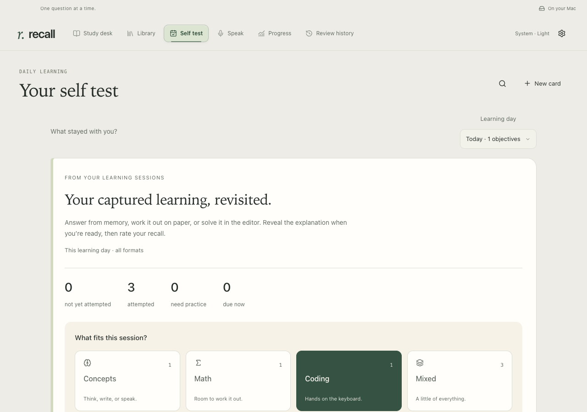
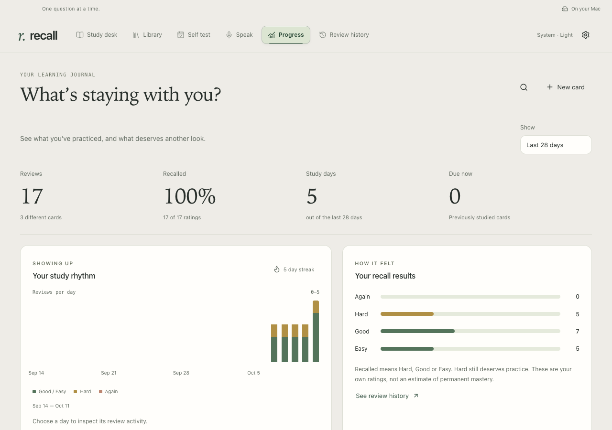
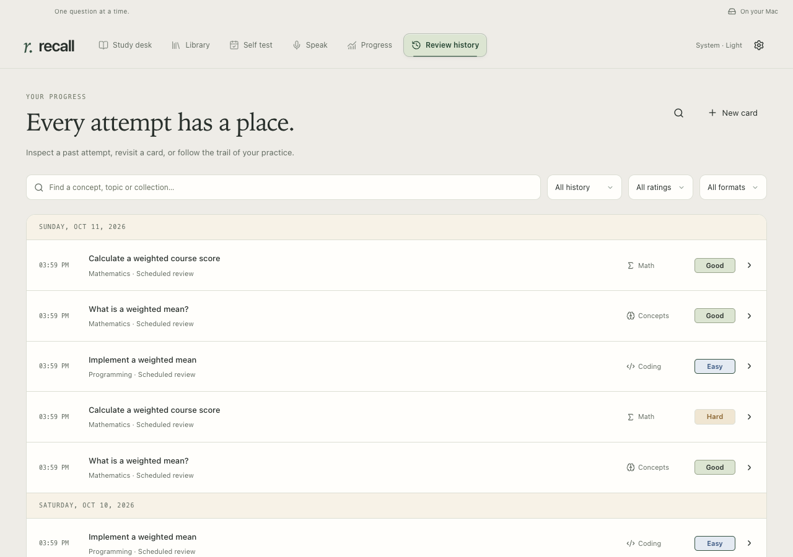

# Keep what you learn

[All walkthroughs](README.md) · [Install Recall](../SETUP.md)

**Goal:** turn useful questions from your day into a small set of ideas you can test later.

## Connect once

1. Open **Settings & backups → Learning connections** and connect Codex, Claude Code or both. Enable learning capture, choose your timezone and save.
2. Start a fresh assistant session. Use **Check readiness** and **Verify learning** to check that a real learning receipt reaches this library.
3. If you want longer notes, open **Knowledge sources**. Connect existing Markdown, Obsidian or Notion notes, or choose **Create my first knowledge base**. You can select several destinations: one primary home, with optional mirrors.

Local sources use the folder you select. Notion needs your assistant's working connector; follow **Finish Notion with assistant** when the setup is pending. Assistants write within the access you grant, verify the primary note, then mirror it. This is a guided workflow rather than continuous background syncing.

## Learn wherever you work

You can ask questions in another connected project without opening the Recall repository. For example:

> Explain weighted means with a concrete example. Use my connected learning skills to reuse or create the relevant Recall questions, and capture only what we discuss.

Read the assistant's receipt:

- **Reused:** a suitable card already covers this objective.
- **New:** a validated card was added.
- **Pending:** something still needs authoring, a source or a quality check.

Math and coding supplements are considered where they test something useful; every definition does not need both. Say **“Don't capture this discussion”** when you want to skip it. Capture is for substantive learning, not every operation or message.

## Test the day

1. Ask your assistant to **prepare today's Recall Self Test from captured learning**. Scheduling this preparation is optional and belongs to your assistant's scheduling setup.
2. Open **Self test**, choose the day and the format you can manage, then answer from memory.
3. Return to an earlier day with **Review needs practice** or **Review all cards**.

Today's test covers today's captured learning. Older cards due for another review appear in **Study desk**. Rating a Self Test card updates the same original card; encountering an idea in chat never rates it or establishes mastery.

Inspect a past review

Open **Review history** to see actual recorded answers and ratings.

**Expected outcome:** useful learning has a traceable receipt, ready cards are available to test, and unfinished gaps stay visible.

**Need help?** See the [learning workflow](../WORKFLOW.md) for paused capture, pending items and optional catch-up. [Knowledge sources](../KNOWLEDGE.md) explains primary notes and mirrors.
