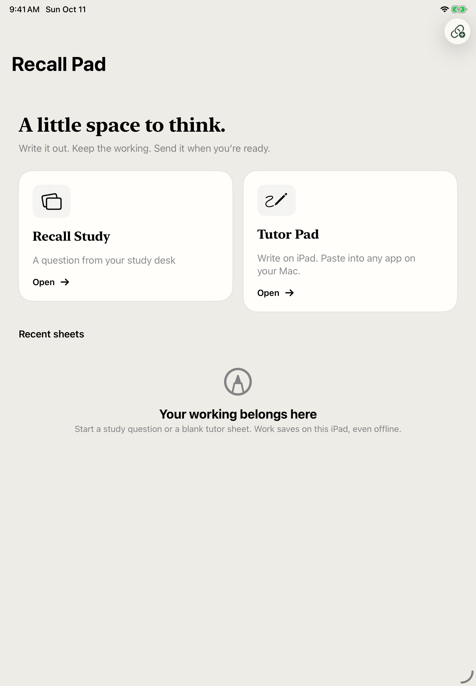

# Write on Recall Pad

[All walkthroughs](README.md) · [Install Recall](../SETUP.md)

**Goal:** use your iPad and Pencil as a notepad, then discuss the actual handwritten steps on your Mac.

Recall Pad is optional and installed separately. Invited testers use TestFlight; a personal Xcode build is also available. Follow the [iPad setup guide](../SETUP.md#optional-ipad-companion) before this walkthrough.

## Pair once

1. Keep your Mac and iPad on the same local network. In Recall, open **Settings & backups → iPad & handwriting** and enable the companion.
2. Choose **Pair an iPad**. In Recall Pad, choose **Pair with Mac** and scan the QR code. Confirm the iPad on your Mac.
3. Leave Recall running while transferring work. Closing its window keeps the enabled receiver running; **Quit Recall** stops it.

Pairing survives ordinary restarts and updates. Your sheets autosave on the iPad, including offline work. Reopen both apps and reconnect in the foreground to transfer queued submissions.

_Choose Recall Study for a card, or Tutor Pad for your conversation. This is a simulator screenshot._

See the iPad’s dark appearance

Paper and ink follow the iPad’s appearance. Exported pages use a readable white background.

## Choose your workflow

| Recall Study                                                                                                                                                                                                     | Tutor Pad                                                                                                                                                      |
| :--------------------------------------------------------------------------------------------------------------------------------------------------------------------------------------------------------------- | :------------------------------------------------------------------------------------------------------------------------------------------------------------- |
| Start from a concept or math card on the Mac. Choose **Write on iPad**, work, then **Send for feedback**. Inspect the saved pages and feedback in Recall. Reveal the worked solution and rate the card yourself. | Start from your learning conversation. Ask the assistant to put a useful problem or note prompt on the pad. Submit your work and discuss it in that same chat. |

Recall Study follows the Mac's next question with a small three-question desk. Earlier sheets remain saved. Coding stays in the Mac editor.

## Learn with your chat tutor

1. Under **Settings & backups → iPad & handwriting → Learn on paper with your tutor**, connect the paper tools to Codex or Claude Code, then start a fresh assistant session. The workflow is Codex-first; verify page delivery in the client you use.
2. In that chat, say **“Start a paper learning session for linear algebra.”** Continue talking normally. Ask for a problem, hint or a writing prompt when useful.
3. Open the prompt in Tutor Pad and write. Each published prompt has its own sheet. With **Follow tutor** on, a new prompt saves the earlier work before switching sheets. Reconnecting keeps your work open; turn **Follow tutor** back on when ready.
4. Choose **Send to tutor**. If the assistant is waiting, it can receive the pages in its active turn. Otherwise say **“Check my paper”** in the original chat.
5. Discuss your reasoning and ask for the next problem when ready. Ask to end the paper session when you finish; the saved work remains.

The assistant can wait for up to 30 seconds at a time. Submission does not wake an idle chat, paste into a draft or automatically ask another question. **Received on Mac** means saved; **Available to tutor** means the assistant accessed the pages, not that it evaluated them.

The paper session has no countdown and stays linked across ordinary Mac restarts. Start a new session if a chat loses its link, after restoring a backup, or after 1,000 published prompts. Writing a Tutor sheet does not itself create a flashcard or knowledge-base note; the separate learning connection handles capture.

No connected tools? Use a blank Tutor Pad sheet, choose **Send to Mac**, then **Copy page** in the Mac tray and paste into any chat yourself. Review the attachment and press Send. PNG/PDF export is another option. This manual route is separate from the chat-bound session.

## Keep long work readable

Sending captures the sheet's ink, including work outside the visible screen, and creates ordered pages. It does not send just the latest strokes. Use a new prompt's sheet, or a separate blank sheet, for a different problem.

One submission supports up to **20 pages**, **12 MiB per image** and **64 MiB total**, including the editable drawing. In-app export uses the same limits. If work exceeds them, it stays saved; ask your tutor to split future work into smaller writing prompts and submit each sheet separately. Manually created sheets are separate documents, use the manual Mac tray and are not combined into a chat-bound submission. There is no automatic “send only the last problem” selection.

**Expected outcome:** saved handwriting tied to its original question or tutor prompt, with feedback on the Mac. Tutor Pad uses the existing assistant conversation; Recall Study's optional assessment uses your Mac's OpenAI API connection. Neither chooses a review rating for you.

**Need help?** [Recall Pad setup and recovery](../HANDWRITING.md) covers connection problems. [Paper learning](../PAPER_LEARNING.md) explains tool readiness and reconnecting a chat.
