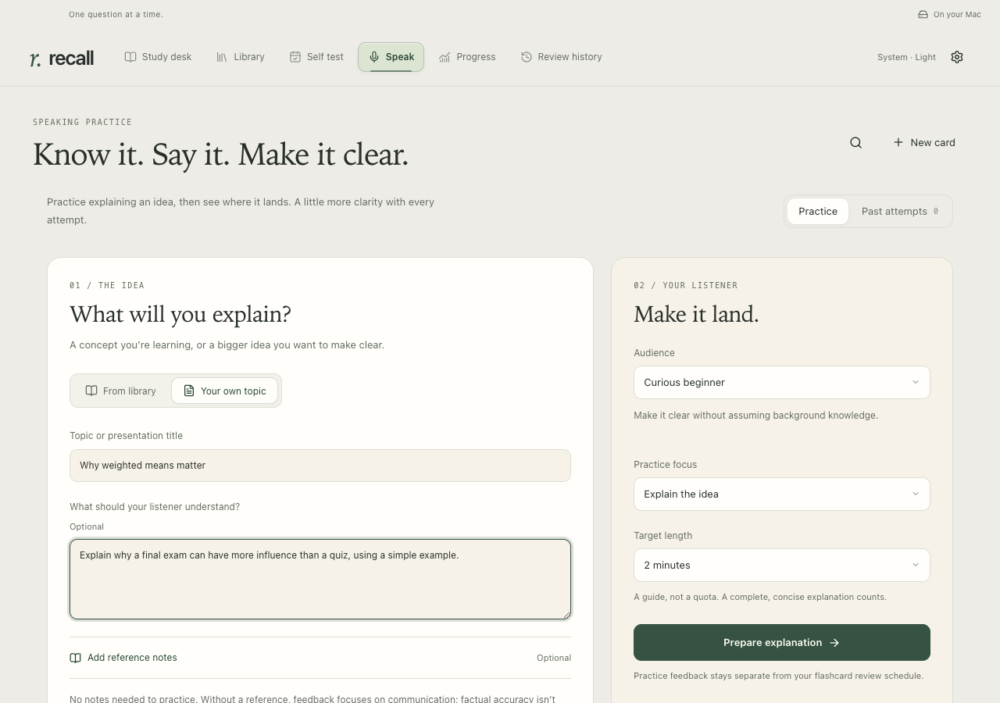

# Explain it to someone

[All walkthroughs](README.md) · [Install Recall](../SETUP.md)

**Goal:** practise explaining an idea clearly, with enough depth for the person listening.

Speak is for an explanation or presentation. The card's compact **Speak / Type** strip is better for a quick flashcard answer.

## Set the scene

1. Open **Speak**. Choose **From library** for a card or configured knowledge-base note, or **Your own topic** for a broader explanation.
2. Choose an audience and focus. A general audience may need a concrete example; a technical peer may need the mechanism. **Walk through a system** fits an architecture or presentation.
3. For a custom topic, add a listener brief and reference notes if useful. Choose a target length.

Try a topic such as **“How our data pipeline works”**. You can use your own reference notes without creating a flashcard first.

## Say it, then review it

1. Start recording, or type your explanation. Recording and evaluation need internet and your own OpenAI API key, saved once in **Settings & backups → Voice & feedback**; API billing is separate from ChatGPT.
2. Stop and edit the transcript so a transcription mistake does not become a content mistake.
3. Request feedback. Review the main point, structure, audience fit and useful detail. With a reference, inspect the source-linked accuracy findings; without one, accuracy is **Not assessed**.
4. Use **One more rep** and **Practice again** for one focused improvement, or try explaining the same idea to a different audience.

For recorded attempts, delivery observations show observed fillers, estimated pace and estimated pauses. These are practice cues, not a rule that good speaking has no fillers or pauses. Typed attempts cannot establish how you sounded.

**Expected outcome:** a saved explanation and specific feedback you can act on. Speak keeps its own history; it does not rate your cards or change review schedules. Recall keeps transcripts and feedback locally and stores no audio recording.

**Need help?** The [Speak guide](../SPEAK.md) explains references, saved attempts and provider failures. Failed feedback keeps your draft.
