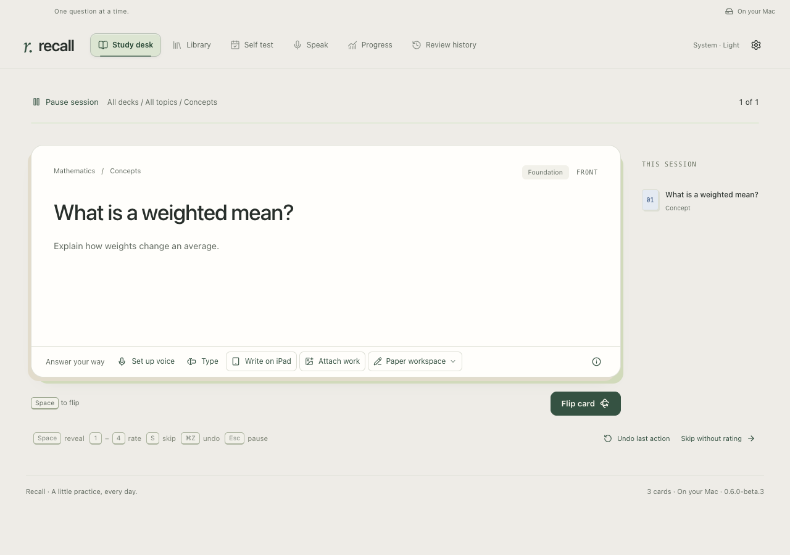
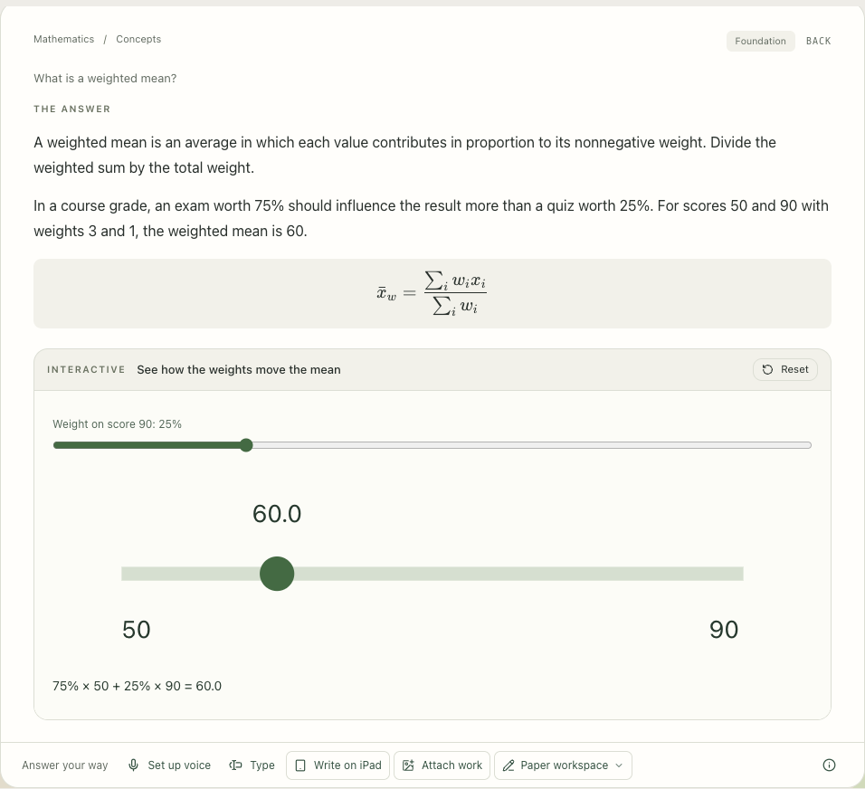
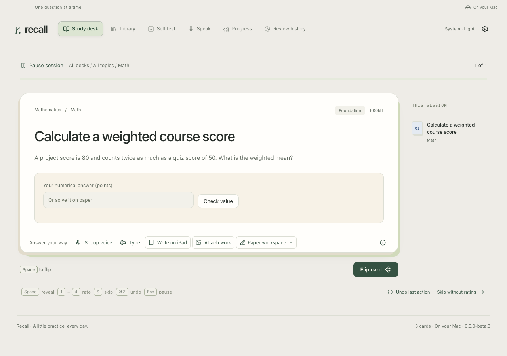
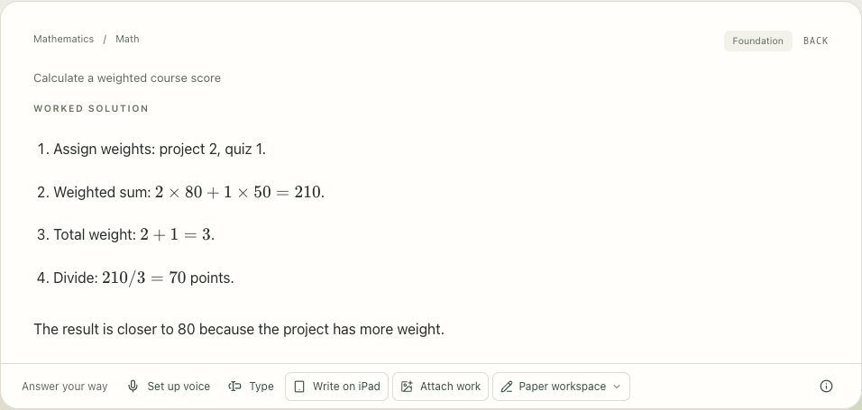
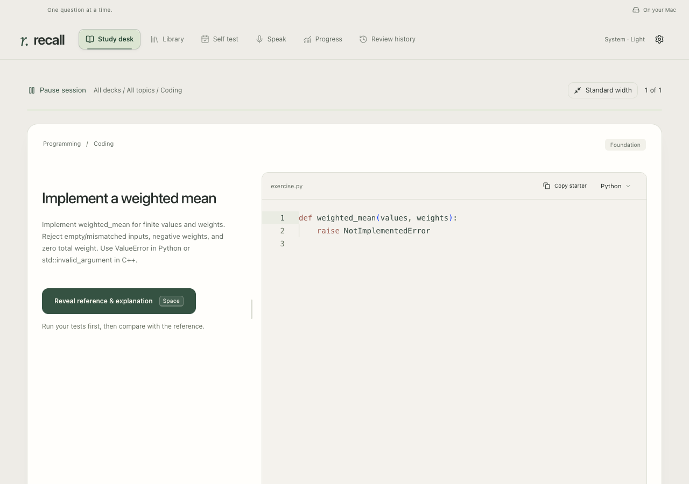

# Study a card

[All walkthroughs](README.md) · [Install Recall](../SETUP.md)

**Goal:** try recalling an idea before looking at its explanation, then return to it when it needs another review.

## Choose what fits today

1. Open **Study desk**. Choose **Concepts**, **Math**, **Coding** or **Mixed**.
2. Choose a collection and, if useful, a topic. Topics are broad subjects; collections group cards you want to study together. **View all collections** opens the rest of your shelf.
3. Choose **Start review** for eligible new and due cards, or **Start practice** to revisit cards without waiting for their due date. Resume an unfinished session when you return.

You can keep the same topic and switch formats. A concepts-only session is useful when you have a few minutes; math and coding can wait until you have room to work.

## Think first, then flip

Answer in your head, on paper, or through the compact **Speak / Type** strip. It expands only when you use it. Optional spoken transcription and answer feedback use your own OpenAI API connection.

Choose **Flip card**, or press **Space** when you are not typing. The back replaces the question with the explanation. Where the card includes one, open its visual or interactive example to explore the idea.

## Work through math or code

| Math                                                                                                                                          | Coding                                                                                                                                            |
| :-------------------------------------------------------------------------------------------------------------------------------------------- | :------------------------------------------------------------------------------------------------------------------------------------------------ |
| Work on paper, attach an image, or use the optional iPad companion. Flip when ready to compare with the worked steps. Solutions begin hidden. | Work in the editor with the supplied starter code. Run the tests when execution is enabled, then explicitly reveal the reference and explanation. |

See the worked steps after revealing

## Choose your next review

After revealing the answer, rate your recall:

- **Again:** you forgot or made a substantive error.
- **Hard:** you were correct, with substantial effort.
- **Good:** you recalled it correctly.
- **Easy:** recall was effortless.

Your rating advances the session. In a review, it also updates that card's next review; **Practice without rescheduling** keeps the schedule unchanged and records the attempt in history. Concept, math and coding cards keep their own review outcomes; AI feedback does not choose a rating for you. **Progress** shows your activity, and **Review history** lets you inspect earlier ratings.

**Expected outcome:** a completed session and a review schedule based on your own answers.

**Need help?** [Troubleshooting](../TROUBLESHOOTING.md) covers unavailable coding tools and other setup issues.
