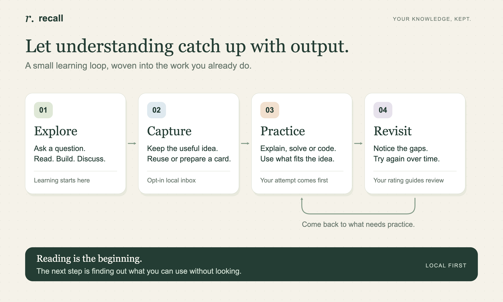
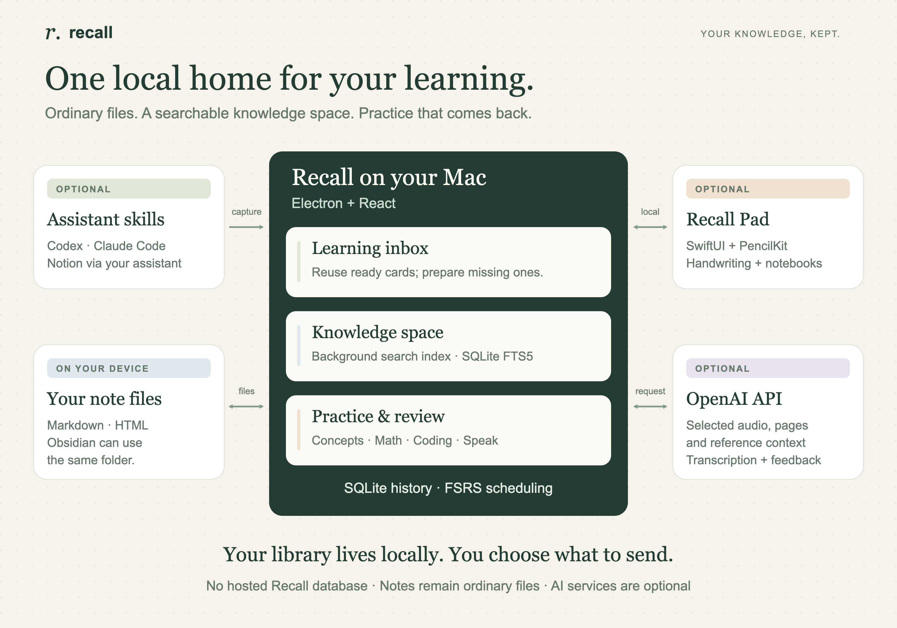

# AI helped me build faster. Was I actually learning?

I've built things with AI that worked, then struggled to clearly explain the decisions behind them.

Why that architecture? What tradeoff did we make? When would this approach break?

I could show you what I'd built. I wasn't always sure I could defend it. That bothered me.

The amount of output we get from AI is staggering: code, debugging explanations, design suggestions, entire implementations. Some of it I read carefully. Some of it I skim. More arrives before I've really absorbed the last answer.

And there's a strange incentive here. Stopping to understand something can feel like falling behind. Why spend twenty minutes learning the mechanism when the model can get you past the problem in seconds?

But if AI keeps writing and debugging for me, what am I getting better at?

I find building much more rewarding when I understand what I'm building. I want the speed. I also want enough knowledge to make the next decision myself.

Andrew Huberman puts it well:

> “All of learning is anti-forgetting.”

— [Huberman Lab](https://www.hubermanlab.com/episode/your-top-health-questions-answered)

That became the premise behind **Recall**, an open-source project I've been building: a place to keep what I'm learning and test whether I can actually use it.

With capture enabled, Codex or Claude Code can record useful concepts from a learning conversation in a local inbox. Existing questions get reused; missing ones can be prepared separately. A daily Self Test brings that day's captured learning back in front of me.

The practice depends on the idea:

- **Concepts:** explain it from memory, then check a definition, concrete example or interactive diagram.
- **Coding:** solve a focused Python or C++ challenge with starter code and tests.
- **Math:** work through a problem, or write the reasoning on Recall Pad with Apple Pencil and send it for feedback. The worked solution stays hidden until revealed.
- **Speaking:** explain a topic to a particular audience and get feedback on accuracy, depth and clarity against supplied references.

A concept only gets math or coding practice when that adds something. I can also choose a concepts-only session when I don't have the time or space to write or code.

For a longer tutoring conversation, I can start a paper-learning session in Codex: a problem appears on the iPad, and my handwritten work comes back to the same chat.

Recall has its own knowledge space, too. I can write a note, find it again, and practice the related ideas. Markdown and HTML stay as ordinary local files; Obsidian can use the same folder. Notion is an optional connection through the assistant.

Underneath, it's **Electron + React** on the Mac, **SQLite** for cards and review history, and **FSRS** for spaced repetition. A separate background worker uses **SQLite FTS5** to index notes. Assistant skills feed a local preparation queue.

The iPad app uses **SwiftUI + PencilKit**, with a paired local connection and a Codex-first paper-learning workflow. Optional OpenAI API calls handle transcription and feedback. There's no hosted Recall database.

It's still a beta. The Mac app is available; the iPad companion is currently available to invited TestFlight testers or through a source build.

[The code, learning skills and setup guide are on GitHub.](https://github.com/justslee/recall)

I want to keep accelerating. I also want the understanding to stay with me after the chat closes.

**How do you decide what to let AI handle—and what you want to understand well enough to do or explain yourself?**
